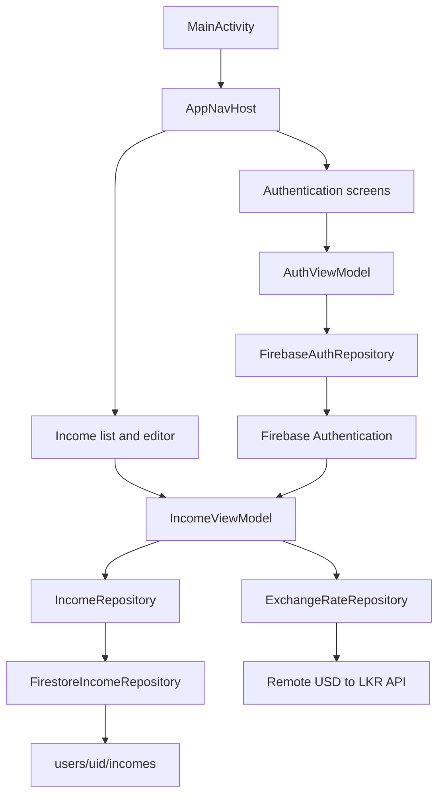
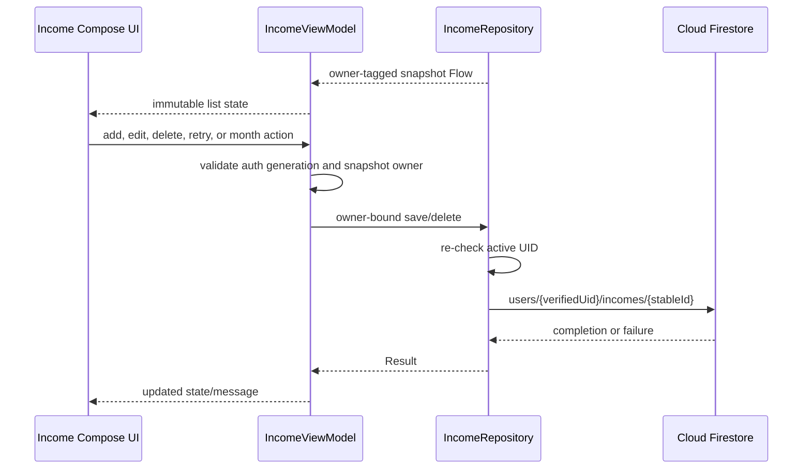

# Application Architecture

This document describes the architecture implemented in the current branch. Items that remain design proposals are labelled explicitly.

For setup and project status, see the [project README](../README.md). For persistence details, see the [Firestore schema](firestore-schema.md). The current Income screen is documented in the [Income wireframe](wireframes/income-screen.md).

## Architecture overview

The application uses a single-activity, feature-based MVVM architecture with Jetpack Compose, Kotlin coroutines and Flow, Hilt, Firebase Authentication, and Cloud Firestore.

### Scenario-to-design boundary

The shared models cover income, expenses, categories, recurring commitments, receivables, and savings goals. Implementation maturity differs by feature. M03 Income is complete through its Compose UI, ViewModel, exchange-rate integration, owner-bound repository, Firestore mapper/observer, rules, and tests. Expense also has a UI/ViewModel and Firestore repository. Several other finance features currently retain repository contracts and in-memory implementations only.

| Layer | Current implementation |
| --- | --- |
| Compose UI | Authentication, Home, Expense, and Income destinations are implemented. Income includes list, add/edit, delete confirmation, loading, empty, error, and retry states. |
| ViewModels | Authentication, Expense, and Income ViewModels expose immutable observable state and execute repository operations. |
| Repositories | Feature interfaces isolate UI/domain code from storage. Income is bound to `FirestoreIncomeRepository`; fakes support deterministic tests. |
| Authentication | `FirebaseAuthRepository` exposes the active UID. Navigation returns signed-out users to the authentication graph. |
| Exchange rates | A remote USD-to-LKR provider is bound through Hilt; the Income editor coordinates automatic quotes and manual fallback. |
| Dependency injection | Hilt modules bind authentication, category, exchange-rate, expense, and income dependencies. |
| Preferences | UID-scoped DataStore remains planned and is outside M03. |

### High-level application architecture

### Income data flow

The observation snapshot carries an immutable owner ID. Edit and delete accept that owner from the rendered row and require a successful current snapshot, a non-blank owner matching authentication, callback-owner equality, and exact record membership. This prevents a stale record from one account becoming a draft or operation for another account, including when both accounts use the same document ID.

### Authentication and protected navigation

`AppNavHost` observes `AuthViewModel.authState`. A non-null UID navigates to Home and removes Login; a null UID navigates back to Login and clears the graph. Income observation switches by UID, emits a signed-out/empty snapshot when required, and cancels the previous Firestore listener through `flatMapLatest`.

`IncomeViewModel` also tracks an authentication generation. A user change clears owner-specific list, form, delete, and message state, and stale asynchronous observation, rate, save, or delete results cannot be applied to the new session. Repository writes independently compare the expected owner with the latest authenticated UID before using a Firestore path.

### Repository relationships

The shared repository contracts remain storage-independent. Current implementations are shown explicitly; a missing Firestore implementation is not implied by the existence of a proposed schema.

```mermaid
classDiagram
    class CategoryRepository {
        <<interface>>
        observeCategories()
        addCategory(category)
        renameCategory(id, newName)
        setCategoryArchived(id, archived)
    }
    class IncomeRepository {
        <<interface>>
        observeIncomeSnapshots(startDate, endDateExclusive)
        saveIncomeForOwner(ownerId, income)
        deleteIncomeForOwner(ownerId, id)
    }
    class ExpenseRepository {
        <<interface>>
        observeExpenses(startDate, endDateExclusive)
        saveExpense(expense)
        deleteExpense(id)
    }
    class GoalRepository {
        <<interface>>
        observeGoals()
        observeContributions(goalId)
        saveGoal(goal)
        setGoalArchived(id, archived)
        addContribution(contribution)
    }
    class RecurringRepository {
        <<interface>>
        observeRecurringExpenses()
        saveRecurringExpense(recurringExpense)
        setRecurringExpenseActive(id, active)
    }
    class ReceivableRepository {
        <<interface>>
        observeReceivables()
        saveReceivable(receivable)
        setReceivableArchived(id, archived)
    }

    CategoryRepository <|.. FakeCategoryRepository
    IncomeRepository <|.. FakeIncomeRepository
    IncomeRepository <|.. FirestoreIncomeRepository
    ExpenseRepository <|.. FakeExpenseRepository
    ExpenseRepository <|.. FirestoreExpenseRepository
    GoalRepository <|.. FakeGoalRepository
    RecurringRepository <|.. FakeRecurringRepository
    ReceivableRepository <|.. FakeReceivableRepository
```

## Project structure and responsibilities

Production Kotlin sources are under `app/src/main/java/com/example/personalfinanceapp`.

| Package or file | Responsibility |
| --- | --- |
| `core/model` | IDs, enums, `Money`, and finance entities |
| `core/money` | Decimal validation and LKR/USD conversion |
| `feature/auth` | Firebase authentication repository, ViewModel, and screens |
| `feature/exchangerate` | Validated USD/LKR quote retrieval and provider metadata |
| `feature/income` | Income contracts, validation, Firestore mapping/observation/repository, rate coordination, ViewModel, and Compose UI |
| `feature/expense` | Expense repository, Firestore implementation, ViewModel, and UI |
| `feature/category`, `feature/goal`, `feature/recurring`, `feature/receivable` | Domain contracts and current in-memory fake implementations for their respective features |
| `navigation` | Authentication-aware Compose navigation |
| `ui/theme` | Material 3 theme |

## Shared model contracts

### IDs and dates

- `UserId` and `DocumentId` are Kotlin aliases of `String`.
- A persisted Income has a stable, non-blank ID. Editing reuses the original ID; only Add creates a new UUID.
- Domain dates use `LocalDate` and are stored as ISO `YYYY-MM-DD` strings. This avoids device-time-zone changes to date-only values.

### Money

`Money` preserves both the original transaction and its historical LKR conversion:

| Field | Kotlin type | Meaning |
| --- | --- | --- |
| `originalAmountDecimal` | `String` | Exact normalized amount in the selected currency; at most two fractional digits |
| `originalCurrency` | `CurrencyCode` | `LKR` or `USD` |
| `rateLkrPerUnitDecimal` | `String` | Exact LKR-per-unit rate; at most six fractional digits |
| `baseAmountMinor` | `Long` | Converted LKR amount in cents |
| `rateSource` | `RateSource` | `LKR_FIXED`, `MANUAL_TRANSFER`, `MANUAL_REFERENCE`, or `EXCHANGE_RATE_API_REFERENCE` |
| `rateDate` | `LocalDate` | Date associated with the stored historical rate |

`MoneyConverter` parses decimal strings with `BigDecimal`, rejects non-positive or over-precision inputs, multiplies the original amount by the LKR-per-unit rate and `100`, then rounds once to an integer minor unit with `RoundingMode.HALF_UP`. `longValueExact()` rejects values outside `Long`. LKR uses rate `1`, source `LKR_FIXED`, and the transaction date as the rate date.

An automatic quote includes full provider timestamps for freshness validation, but Income persists only the applicable `rateDate`. The Income editor's conversion preview displays the stored rate date, not the provider's update timestamp; list rows do not display rate metadata.

### Category

`Category` has `id`, `name`, `defaultSpendingClass`, and `archived`. `SpendingClass` is either `COMMITTED` or `DISCRETIONARY`. Expenses copy both the category ID and name snapshot so historical labels do not have to change when a category is renamed.

`FakeCategoryRepository` seeds Food, Transport, and Bills. It trims names, rejects blank IDs/names and case-insensitive duplicate names, and supports rename and archive/restore operations. Category persistence remains in-memory; no Category Firestore repository or rules are implemented.

### Income

`Income` contains `id`, `source`, `entryKind`, `money`, `occurredDate`, and optional source-specific metadata.

- `SALARY`, `FREELANCE`, and `ADSENSE` are receipt entries.
- `FREELANCE` exposes an optional project reference; blank input is stored as `null`.
- `CRYPTO` is realised P&L and requires `GAIN` or `LOSS`; an asset symbol is optional.
- Optional notes are supported. `receivableId` remains a domain/persistence field but is not entered by the current Income UI.

`IncomeValidator` checks source/entry-kind/P&L relationships and recalculates the exact expected LKR minor value. A stored amount, rate, date, source, or minor-unit value that violates the money contract is rejected by the ViewModel, mapper, repository, and rules at their applicable boundaries.

### Expense

`Expense` has `id`, `categoryId`, `categoryNameSnapshot`, `spendingClass`, `paymentChannel`, `money`, `occurredDate`, and optional `note` and `channelLabel`. Payment channels are `CASH`, `CARD`, `BANK`, and `OTHER`. Category and spending-class snapshots preserve the transaction's original classification.

Both `FakeExpenseRepository` and `FirestoreExpenseRepository` exist; Hilt binds the Firestore implementation. The current Firestore mapper is implemented directly in that repository and uses a flat document shape rather than the nested Income `money` map. Expense observation listens to the signed-in user's collection, then applies the half-open date filter and date/ID ordering in memory. It does not yet use Income's owner-tagged snapshot or authentication-generation protections.

### Goal and contribution

`Goal` has `id`, `name`, `targetAmountMinor`, `startDate`, `targetDate`, and `archived`. The target is represented in LKR minor units.

`Contribution` has `id`, `goalId`, `amountMinor`, `kind`, `occurredDate`, and optional `reversesId` and `note`. Kinds are `OPENING`, `ALLOCATION`, and `REVERSAL`. Contributions model allocation to a goal; they are not automatically Income or Expense. Reversals preserve history by adding a negative record rather than editing the original.

`FakeGoalRepository` and `FirestoreGoalRepository` implement this contract. The production repository stores goals and append-only contributions beneath the authenticated user's path, rejects stale-owner writes, and uses an atomic reversal claim so one original contribution can be reversed only once. Identical retries are idempotent while conflicting ID reuse fails.

### Recurring expense

`RecurringExpense` has `id`, `title`, `categoryId`, `expectedAmountMinor`, `frequency`, `intervalCount`, `anchorDate`, `startDate`, optional `endDate`, `status`, payment-channel metadata, `reminderEnabled`, and `reminderLeadDays`. Frequencies are `WEEKLY`, `MONTHLY`, and `YEARLY`; statuses are `ACTIVE`, `PAUSED`, and `CANCELLED`.

It remains a scheduling template rather than an Expense. `FirestoreRecurringRepository` persists templates and immutable confirmed/skipped occurrence records. Confirmation atomically creates one deterministic linked Expense; retrying the same occurrence returns that Expense instead of duplicating it. `RecurringViewModel` derives pending dates, supports confirm/skip and pause/resume/cancel, and synchronizes Android alarms. Reminder delivery requires notification permission and the scheduled owner to still be authenticated. Logout cancels known alarms and clears that user's local reminder records; the owner check also blocks stale alarms after logout or account switching.

### Receivable

`Receivable` has `id`, `title`, `projectReference`, `expectedOriginalDecimal`, `currency`, `expectedDate`, and `archived`. It records an expectation only. It has no exchange-rate snapshot or LKR base amount and must not be counted as received Income.

`FakeReceivableRepository` trims and validates its text fields, parses the positive amount with `BigDecimal`, and supports archive/restore. No Receivable UI or Firestore repository is implemented. An actual receipt requires a separate Income, optionally linked by `receivableId`.

## Income feature behavior

### List, Add/Edit, and Delete

The Income list observes a half-open monthly range, shows the stored entries and net LKR total, supports previous/next month navigation, and exposes Add, Edit, and Delete actions. Loading, empty, observation-error/retry, delete-progress, and operation messages are represented explicitly.

Add starts a fresh stable ID with Salary, LKR, and today's date. Edit hydrates the selected stored record, including its original currency and historical exchange-rate snapshot. Closing an editor with Back or Cancel is immediate when no save is in progress; there is no dirty-form discard confirmation.

Delete requires confirmation. The ViewModel validates the snapshot owner and exact selected record before opening the confirmation, then calls `deleteIncomeForOwner`. Failure leaves the list intact and provides a retryable user operation.

### Currency and exchange-rate selection

- LKR is fixed at rate `1`, source `LKR_FIXED`, with rate date equal to transaction date.
- USD Automatic mode requests a validated USD-to-LKR reference quote. It provides loading, refresh, retry, and an explicit switch to manual entry when retrieval fails.
- USD Manual mode accepts a positive rate with at most six fractional digits, a rate date, and either `MANUAL_TRANSFER` or `MANUAL_REFERENCE`.
- A validated automatic quote is stored as `EXCHANGE_RATE_API_REFERENCE` with its applicable date.
- Existing USD Income opens without a network request. Saving an otherwise unchanged historical record preserves its amount, rate, source, rate date, and LKR minor snapshot. Changing the amount reuses the preserved rate until the user explicitly refreshes or replaces it.

### Saving

The form validates fields and shows inline errors. Saving disables form actions while the owner-bound request is active. Add and Edit both call `saveIncomeForOwner` using the owner captured when the form was created, never a newly looked-up UID. On success the editor closes; on failure it remains open with an error. Stable IDs make retried writes update the same document rather than creating duplicates.

## Repository architecture

`IncomeRepository` exposes owner-tagged observation snapshots plus compatibility list observation, and both general and explicitly owner-bound save/delete methods. Production UI uses the owner-bound operations.

| Implementation | Purpose |
| --- | --- |
| `FirestoreIncomeRepository` | Validates Income, re-checks the active UID, maps schema version 1, and writes/deletes beneath the verified user's path |
| `IncomeFirestoreObserver` | Switches authenticated listeners, clears old-account data, maps snapshots, and propagates errors |
| `FakeIncomeRepository` | Deterministic, owner-aware process-local storage for unit tests |

The Firestore observer queries `users/{uid}/incomes` with `startDate <= occurredDate < endDateExclusive` and orders by `occurredDate` then document ID. Mapping requires exact supported field sets, path/field ID equality, valid enum/date types, and domain-valid money.

| Interface | Observable methods | Commands | Implemented storage |
| --- | --- | --- | --- |
| `CategoryRepository` | `observeCategories()` | add, rename, archive | In-memory fake only |
| `IncomeRepository` | owner-tagged/list date-range observation | save/delete, including owner-bound variants | Firestore production binding plus in-memory fake |
| `ExpenseRepository` | date-range observation | save/delete | Firestore production binding plus in-memory fake |
| `GoalRepository` | goals and contributions by goal | save/archive goal, add contribution/reversal | Firestore production binding plus in-memory fake |
| `RecurringRepository` | recurring templates and occurrence ledger | save, pause/resume/cancel, confirm/skip | Firestore with in-memory fake for tests |
| `ReceivableRepository` | receivables | save, archive/restore | In-memory fake only |

Fake repositories use `MutableStateFlow` and `Mutex` for deterministic process-local behavior. Their contents disappear with the repository instance/process and do not provide cloud persistence, cross-device synchronization, or server-side security.

## Architecture decisions

### Kotlin

Kotlin supplies null safety, data classes, sealed/serializable routes, coroutines, and concise Android APIs. Domain models and finance calculations use Kotlin throughout; financial decimals deliberately use `BigDecimal` rather than binary floating point.

### Jetpack Compose and Material 3

Compose renders immutable state declaratively, while Material 3 provides the design system. Authentication, dashboard, Category, Expense, Income, Receivable, Goal summary, Recurring Commitments, Due Items, and More/Preferences screens are implemented. Goal creation and contribution-management controls remain outside the current UI.

### Single-activity architecture

One `MainActivity` hosts the Compose tree and `AppNavHost`. This centralizes app-level theme, authentication routing, and feature navigation without per-feature activities or fragments.

### MVVM

ViewModels coordinate lifecycle-aware state and asynchronous work while repositories isolate persistence. Authentication, dashboard, Category, Expense, Income, Receivable, and Recurring features use this separation. Goal progress is consumed by the dashboard, while full goal-management UI remains incomplete.

### Hilt

`FinanceApplication` and `MainActivity` enable Hilt. Modules bind Authentication, Category, Exchange Rate, Expense, Income, Goal, Receivable, Recurring, reminder coordination, and shared clock/database dependencies. Production finance repositories use Firestore where their modules specify it.

### Coroutines and Flow

Suspending repository commands avoid blocking the main thread and `Flow` streams authentication and list state. Income adapts Firestore listeners with cancellation on UID or date-range changes. Fake repositories use Flow for deterministic in-process observation.

### Repository interfaces

Interfaces keep domain consumers independent of Firebase and allow in-memory test implementations. Observable methods return `Flow`; commands return `Result<Unit>` for expected failures. Income extends this pattern with immutable owner-tagged snapshots and explicit owner-bound commands.

### Decimal-safe financial values

No financial calculation uses `Double` or `Float`. Decimal strings preserve input and rate precision, `BigDecimal` performs conversion, and LKR totals use integer minor units. The rounding policy and boundary/overflow behavior are covered by JVM tests.

### Firebase ownership

Income data is stored below `users/{uid}/incomes/{incomeId}`. The client uses three reinforcing boundaries: authentication-aware observation, ViewModel snapshot/auth-generation checks, and repository expected-owner checks. Checked-in Firestore rules require the authenticated UID to match the user path and validate the Income schema. Local files do not prove that those rules or indexes are deployed.

### General security architecture

- Firebase Authentication is the identity authority; a UID supplied by UI state or document content is never authentication proof.
- Firestore client access is scoped below `users/{uid}`, and checked-in rules require `request.auth.uid == uid` for implemented Category, Income, Expense, Receivable, Recurring, Goal, and Contribution paths.
- Unmatched rule paths are denied. Preference paths are not client-accessible merely because they are documented.
- Income additionally verifies owner continuity in its observer, ViewModel callbacks/drafts, authentication generation, and repository commands. The current Expense implementation does not yet claim those Income-specific safeguards.
- Logout removes protected navigation state. Feature listeners/state must also be cancelled or cleared on UID changes; Income and Goal observation are account-aware, while recurring reminders additionally carry an owner guard and are cleared during sign-out.
- Local Firebase caches may retain bytes on disk. Cached data must never be treated as authority for a different UID, and shared-device/cache policy still requires deployment-environment verification.
- Privileged administration belongs outside the Android client. Rules and Emulator Suite tests are necessary, while deployment evidence must be recorded separately.

### UID-scoped preferences with DataStore

UID-scoped Android DataStore remains proposed as the authoritative preference store. This branch has no preferences model, repository, or DataStore implementation. A Firestore preferences document is only an optional cloud-synchronization proposal and must not become a second authority without an approved conflict, migration, offline, logout, and user-switch design.

## Completed responsibilities and remaining scope

- **M02 complete:** shared `Money` model, validation, exact conversion, precision limits, `HALF_UP` rounding, overflow handling, and tests.
- **M03 complete:** Income list/add/edit/delete UI, automatic/manual exchange rates, validation, historical snapshots, ViewModel behavior, owner-bound Firestore observation/save/delete, mapping, DI, rules, and regression coverage.
- **R06 implemented:** recurring commitment list/editor, due-item actions, deterministic due dates, pause/resume/cancel, atomic confirmation-to-Expense, skip handling, reminder scheduling, navigation, rules, and focused tests.
- **R07 verification:** goal ledger regressions, recurring idempotency, restart resynchronization, notification permission, logout/account-switch protection, and cross-feature regression coverage.
- **Outside M03:** UID-scoped DataStore preferences and completing the remaining finance features. Firebase deployment status must be tracked separately from repository implementation.
