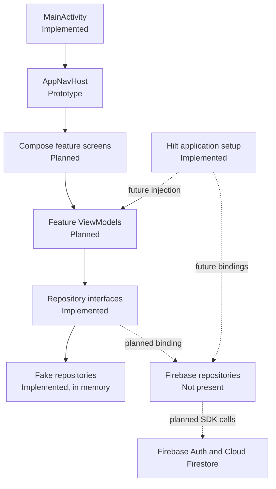
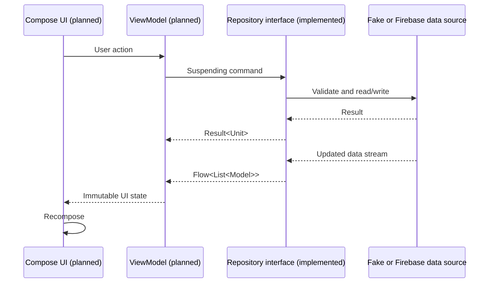
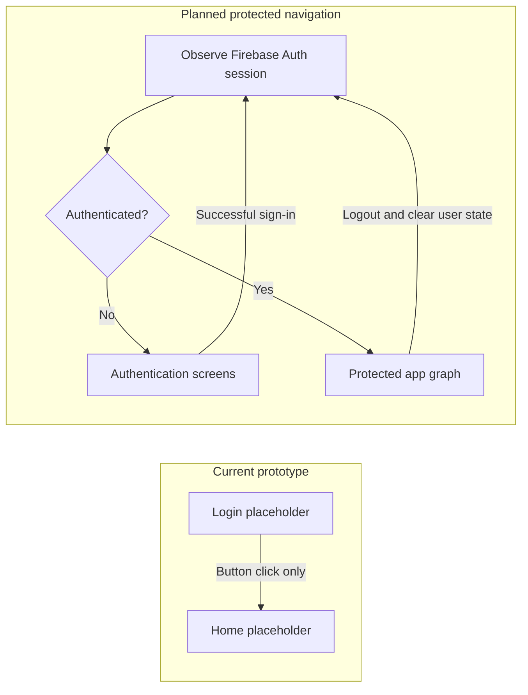

# Application Architecture

This document describes the architecture visible in the current branch and the intended direction supplied by the project brief. Labels such as **Implemented**, **Prototype**, and **Planned** are used to avoid presenting design intentions as completed work.

For setup and project status, see the [project README](../README.md). For persistence design, see the [Firestore schema](firestore-schema.md).

## Architecture overview

The project follows a feature-based, MVVM-style direction within a single Android application module.

- **Compose UI:** `MainActivity` installs the Material theme and calls `AppNavHost`. The navigation destinations currently render placeholder Compose content.
- **ViewModels:** **Planned.** No class extending `ViewModel` exists in this branch. Feature ViewModels should own screen state, call repository contracts, and collect `Flow` values without placing data access in composables.
- **Repository interfaces:** **Implemented.** Each finance feature exposes a small contract based on suspending commands and observable `Flow` queries.
- **Data sources:** The current fake repositories are **implemented in-memory data sources**. Firebase-backed data sources and repository implementations are **planned** but absent.
- **Dependency injection:** Hilt is initialized through `@HiltAndroidApp` and `@AndroidEntryPoint`. Repository modules/bindings are **planned**; no Hilt module is present.

MVVM is useful here because it separates rendering, state coordination, and persistence. Compose functions can stay declarative, ViewModels can survive configuration changes and expose stable UI state, and repositories can be exchanged without changing feature UI code.

### High-level application architecture

### Data flow

The arrows below describe the intended runtime flow. The repository contract and fake implementation portions are already available; the feature UI and ViewModel portions are not.

### Authentication and protected navigation

The current graph does **not** protect `Home`: it starts at `Login`, and a button navigates to `Home` without authenticating. The following diagram separates that prototype from the intended design.

The planned implementation should derive access from the active Firebase Authentication UID, clear user-specific in-memory state on logout, and prevent stale data from one user being displayed to another.

### Repository relationships

```mermaid
classDiagram
    class CategoryRepository {
        <<interface>>
        observeCategories()
        addCategory(category)
        renameCategory(id, newName)
        setCategoryArchived(id, archived)
    }
    class IncomeRepository {
        <<interface>>
        observeIncomes(startDate, endDateExclusive)
        saveIncome(income)
        deleteIncome(id)
    }
    class ExpenseRepository {
        <<interface>>
        observeExpenses(startDate, endDateExclusive)
        saveExpense(expense)
        deleteExpense(id)
    }
    class GoalRepository {
        <<interface>>
        observeGoals()
        observeContributions(goalId)
        saveGoal(goal)
        setGoalArchived(id, archived)
        addContribution(contribution)
    }
    class RecurringRepository {
        <<interface>>
        observeRecurringExpenses()
        saveRecurringExpense(recurringExpense)
        setRecurringExpenseActive(id, active)
    }
    class ReceivableRepository {
        <<interface>>
        observeReceivables()
        saveReceivable(receivable)
        setReceivableArchived(id, archived)
    }

    CategoryRepository <|.. FakeCategoryRepository
    IncomeRepository <|.. FakeIncomeRepository
    ExpenseRepository <|.. FakeExpenseRepository
    GoalRepository <|.. FakeGoalRepository
    RecurringRepository <|.. FakeRecurringRepository
    ReceivableRepository <|.. FakeReceivableRepository

    CategoryRepository <|.. PlannedFirebaseCategoryRepository
    IncomeRepository <|.. PlannedFirebaseIncomeRepository
    ExpenseRepository <|.. PlannedFirebaseExpenseRepository
    GoalRepository <|.. PlannedFirebaseGoalRepository
    RecurringRepository <|.. PlannedFirebaseRecurringRepository
    ReceivableRepository <|.. PlannedFirebaseReceivableRepository
```

The `PlannedFirebase...` names are diagram labels, not classes that exist in the repository.

## Project structure and responsibilities

The current production Kotlin sources are under `app/src/main/java/com/example/personalfinanceapp`.

| Package or file | Status | Responsibility |
| --- | --- | --- |
| `core/model` | Implemented | Shared IDs, enums, money value, and finance entity contracts |
| `feature/category` | Contract and fake implemented | Observe, create, rename, and archive categories |
| `feature/income` | Contract and fake implemented | Observe income in a half-open date range, save/update, and delete |
| `feature/expense` | Contract and fake implemented | Observe expenses in a half-open date range, save/update, and delete |
| `feature/goal` | Contract and fake implemented | Manage goals and append contributions/reversals |
| `feature/recurring` | Contract and fake implemented | Manage recurring expense templates and active state |
| `feature/receivable` | Contract and fake implemented | Manage expected payments and archive state |
| `navigation` | Prototype | Serializable `Login`/`Home` routes and root Compose `NavHost` |
| `ui/theme` | Implemented foundation | Material 3 colours, typography, and application theme |
| `FinanceApplication.kt` | Implemented foundation | Hilt-enabled Android `Application` |
| `MainActivity.kt` | Implemented foundation | Single activity, edge-to-edge setup, theme, and navigation host |

There is no feature package containing Compose screens or ViewModels beyond the placeholder content inside `AppNavHost`. There are also no dedicated `validation`, `calculation`, `data`, `firebase`, or dependency-injection module packages in this branch. Money rules currently exist only as model conventions and limited validation inside fake repositories.

### Feature package notes

- **Category:** seeds `Food`, `Transport`, and `Bills` in memory. It rejects blank IDs/names and case-insensitive duplicate names, and supports rename/archive operations.
- **Income:** stores entries in memory, upserts by stable ID, deletes by ID, and observes entries where `startDate <= occurredDate < endDateExclusive`, sorted by date then ID.
- **Expense:** mirrors income's in-memory upsert/delete/date-range behaviour for expenses.
- **Goal:** stores goals and contributions separately in memory. Contributions are append-only by ID; an identical retry is idempotent, while a changed record with the same ID fails. A reversal must negate one existing non-reversal contribution and may occur only once.
- **Recurring:** stores templates in memory, validates positive amount and interval, date order, and non-negative reminder lead time, and supports pause/reactivation.
- **Receivable:** stores expected payments in memory, trims text fields, validates a positive decimal amount with `BigDecimal`, and supports archive/restore.

## Shared model contracts

All current IDs are Kotlin type aliases over `String`. The aliases improve domain readability but do not add runtime validation.

### IDs and dates

- `UserId` and `DocumentId` are both aliases of `String`.
- Stable, non-blank document IDs are expected by repository operations. The fake repositories enforce this for saved entities; category seed IDs are readable slugs.
- Domain dates use `java.time.LocalDate`, available because the minimum SDK is 26.
- The proposed Firestore mapping serializes date-only values as ISO `YYYY-MM-DD` strings so device time zones cannot change the calendar date.

### Money

`Money` captures both the original transaction and its LKR conversion:

| Field | Kotlin type | Meaning |
| --- | --- | --- |
| `originalAmountDecimal` | `String` | Exact user-entered amount in the original currency |
| `originalCurrency` | `CurrencyCode` | `LKR` or `USD` |
| `rateLkrPerUnitDecimal` | `String` | Historical LKR-per-unit exchange rate |
| `baseAmountMinor` | `Long` | Converted LKR amount in minor units (cents) |
| `rateSource` | `RateSource` | `LKR_FIXED`, `MANUAL_TRANSFER`, or `MANUAL_REFERENCE` |
| `rateDate` | `LocalDate` | Date associated with the preserved rate |

Decimal strings avoid binary floating-point loss. Calculations should parse them with `BigDecimal`, apply an agreed rounding policy, and persist the resulting LKR minor-unit `Long`; that calculation/rounding implementation is not present in this branch.

### Category

`Category` has `id`, `name`, `defaultSpendingClass`, and `archived`. `SpendingClass` is either `COMMITTED` or `DISCRETIONARY`. Expenses copy both the category ID and name snapshot so historical labels need not change when a category is renamed.

### Income

`Income` has `id`, `source`, `entryKind`, `money`, and `occurredDate`, with optional `pnlDirection`, `projectReference`, `receivableId`, `assetSymbol`, and `note`.

- Sources: `SALARY`, `FREELANCE`, `ADSENSE`, `CRYPTO`.
- Entry kinds: `RECEIPT`, `REALIZED_PNL`.
- P&L direction: `GAIN` or `LOSS` when applicable.

A receivable reference can connect a later receipt to an expected payment. The receivable itself is not income until an income record is created.

### Expense

`Expense` has `id`, `categoryId`, `categoryNameSnapshot`, `spendingClass`, `paymentChannel`, `money`, `occurredDate`, and optional `note` and `channelLabel`. Payment channels are `CASH`, `CARD`, `BANK`, and `OTHER`.

### Goal and contribution

`Goal` has `id`, `name`, `targetAmountMinor`, `startDate`, `targetDate`, and `archived`. The target is represented in LKR minor units.

`Contribution` has `id`, `goalId`, `amountMinor`, `kind`, `occurredDate`, and optional `reversesId` and `note`. Kinds are `OPENING`, `ALLOCATION`, and `REVERSAL`. Contributions model allocation to a goal; they are not automatically an income or expense. Reversals preserve history by adding a negative record rather than editing the original.

### Recurring expense

`RecurringExpense` has `id`, `title`, `categoryId`, `expectedAmountMinor`, `frequency`, `intervalCount`, `anchorDate`, `startDate`, optional `endDate`, `active`, `reminderEnabled`, and `reminderLeadDays`. Frequencies are `WEEKLY`, `MONTHLY`, and `YEARLY`.

It is a scheduling template, not a confirmed expense. No occurrence-generation, skip, notification, or template-to-expense code exists in this branch.

### Receivable

`Receivable` has `id`, `title`, `projectReference`, `expectedOriginalDecimal`, `currency`, `expectedDate`, and `archived`. It records an expectation only. It does not include an exchange-rate snapshot or LKR base amount and must not be counted as received income.

## Repository architecture

All observable methods return `Flow<List<T>>`; all commands return `Result<Unit>`. This allows a future data layer to stream database changes and report expected operation failures without binding callers to Firebase APIs.

| Interface | Query methods | Command methods | Current implementation |
| --- | --- | --- | --- |
| `CategoryRepository` | `observeCategories()` | `addCategory`, `renameCategory`, `setCategoryArchived` | `FakeCategoryRepository` |
| `IncomeRepository` | `observeIncomes(startDate, endDateExclusive)` | `saveIncome`, `deleteIncome` | `FakeIncomeRepository` |
| `ExpenseRepository` | `observeExpenses(startDate, endDateExclusive)` | `saveExpense`, `deleteExpense` | `FakeExpenseRepository` |
| `GoalRepository` | `observeGoals()`, `observeContributions(goalId)` | `saveGoal`, `setGoalArchived`, `addContribution` | `FakeGoalRepository` |
| `RecurringRepository` | `observeRecurringExpenses()` | `saveRecurringExpense`, `setRecurringExpenseActive` | `FakeRecurringRepository` |
| `ReceivableRepository` | `observeReceivables()` | `saveReceivable`, `setReceivableArchived` | `FakeReceivableRepository` |

The fake repositories use `MutableStateFlow` as process-local storage and `Mutex` to serialize writes. Their state disappears when the repository instance or application process is discarded. They support deterministic unit tests and parallel UI development without network access, but they do not implement authentication, persistence, offline Firestore caching, cross-device synchronization, or security enforcement.

**No repository currently uses Firebase.** Firebase Authentication and Firestore are build dependencies only. There are no production repository implementations, Firebase SDK calls, data-transfer objects, mappers, snapshot listeners, or DI bindings in this branch.

## Architecture decisions

### Kotlin

Kotlin provides null safety, data classes, sealed/serializable route support, coroutines, and concise Android APIs. It is fully configured and used throughout the project.

### Jetpack Compose and Material 3

Compose supplies declarative UI and integrates with observable state; Material 3 provides the design system. The theme and placeholder destinations are implemented, while complete feature screens are planned.

### Single-activity architecture

One `MainActivity` hosts the Compose tree and navigation graph. This centralises app-level theming and navigation and avoids fragment/activity transitions for individual features. This structure is implemented.

### MVVM

MVVM is the intended separation between Compose rendering, lifecycle-aware state holders, and repositories. It reduces UI/data coupling and makes state logic testable. Repository contracts exist, but the ViewModel layer is not implemented, so the current branch is not yet a complete MVVM implementation.

### Hilt

Hilt is intended to construct ViewModels and select fake or Firebase repository implementations. Application/activity integration is present. Modules, scopes, and bindings are not yet present.

### Coroutines and Flow

Suspending commands avoid blocking the main thread, while `Flow` supports continuously updated lists. The fake repositories implement these patterns now. Future Firestore snapshot listeners should be adapted into cold or callback-based flows with correct cancellation and error handling.

### Repository interfaces

Interfaces keep domain consumers independent of storage technology. They allow in-memory implementations for tests and Firebase implementations for production, and create a clear boundary for validation and mapping. The interfaces and fakes are implemented.

### Firebase Authentication and Firestore

Firebase is intended to provide identity, synchronized persistence, and offline-capable Android clients. Dependencies and Android configuration are present, but actual sign-in, user scoping, Firestore access, security rules, and indexes are not implemented on this branch. The proposed user-owned layout is documented in [firestore-schema.md](firestore-schema.md).

### Decimal-safe financial values

Binary floating-point values can introduce rounding errors that are unacceptable for finance. The models therefore preserve input amounts and rates as decimal strings and store converted LKR values as integer minor units. `Receivable` validation already uses `BigDecimal`; a shared conversion and rounding policy remains planned.

## Current limitations and intended next steps

The architecture foundation should not be confused with a production-ready data path. The next integration steps are to add feature ViewModels and screens, define Hilt repository bindings, implement Firebase Authentication session handling, implement explicit Firestore mappers/repositories, add security rules and rule tests, and protect the app navigation graph. Those changes should preserve the existing repository contracts unless requirements force a reviewed contract change.
