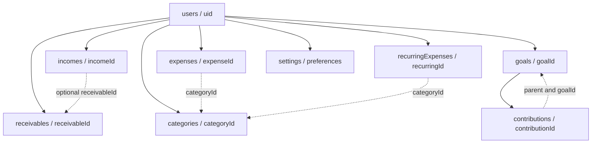

# Firestore Schema and Security Plan

This document separates the Firebase state verified in the current branch from a proposed Firestore design derived from the Kotlin model and repository contracts. It does not describe deployed infrastructure.

For application structure and model rationale, see [Application Architecture](architecture.md). For development setup, see the [project README](../README.md).

## Verified Firebase status

| Item | Verified state in this branch |
| --- | --- |
| Google Services Gradle plugin | Configured |
| Firebase BOM | Configured at 34.19.0 |
| Firebase Authentication dependency | Declared |
| Cloud Firestore dependency | Declared |
| Android Firebase configuration | Present; package name matches the application ID |
| Firebase SDK calls | None found |
| Firebase-backed repositories | None found |
| Implemented Firestore collections | None evidenced by source or configuration |
| `firestore.rules` | Not present |
| Security-rule tests | Not present |
| `firestore.indexes.json` | Not present |
| Rules/index deployment | Cannot be verified and is not claimed |

The Android configuration file proves only that the application has Firebase client configuration. It does not prove that Authentication providers, Firestore collections, security rules, or indexes have been created or deployed. Configuration values are intentionally omitted from this documentation.

## Proposed document hierarchy

Everything in this section is **Proposed Schema**. It is based on current model field names and the required user-owned layout; no corresponding Firestore implementation exists on this branch.

```text
users/{uid}
├── incomes/{incomeId}
├── expenses/{expenseId}
├── categories/{categoryId}
├── receivables/{receivableId}
├── recurringExpenses/{recurringId}
├── goals/{goalId}
│   └── contributions/{contributionId}
└── settings/preferences
```



No recurring occurrence or skip subcollections are proposed here because the current models, repository contracts, and repository files contain no occurrence/skip contract. Add them only after the team defines lifecycle, idempotency, and expense-confirmation behaviour.

## Shared storage conventions

### IDs

- Use the authenticated Firebase UID as `{uid}`.
- Use the model's stable `DocumentId` as the Firestore document ID.
- Store each entity's `id` field as well as using it in the path so direct model mapping remains explicit. Security rules should require the field to equal the path ID.
- Do not silently generate a different ID during an update.

### Dates

All domain dates are `LocalDate`, not instants. Store them as zero-padded ISO strings in `YYYY-MM-DD` form, for example `2026-10-16`. Lexicographic ordering then matches calendar ordering. This is a proposed mapping; no serializer currently exists.

### Money

For `Income` and `Expense`, preserve the Kotlin `Money` object as a map:

| Field | Firestore type | Required | Rule |
| --- | --- | --- | --- |
| `originalAmountDecimal` | string | Yes | Valid canonical decimal string; never a floating-point field |
| `originalCurrency` | string | Yes | Current enum: `LKR` or `USD` |
| `rateLkrPerUnitDecimal` | string | Yes | Valid positive decimal string |
| `baseAmountMinor` | integer | Yes | Signed 64-bit LKR minor units; meaning depends on the entry semantics |
| `rateSource` | string | Yes | `LKR_FIXED`, `MANUAL_TRANSFER`, or `MANUAL_REFERENCE` |
| `rateDate` | string | Yes | ISO date-only string |

Original currency and historical rate data must not be replaced when exchange rates later change. Decimal strings should be parsed with decimal arithmetic such as `BigDecimal`; Firestore double values and Kotlin `Double`/`Float` must not be used for financial calculations. The shared calculation and rounding policy is not yet implemented.

### Domain boundaries

- A savings contribution changes goal allocation; it is not automatically an income or expense.
- A receivable records money expected, not money received. Receipt requires a separate `Income`, optionally linked by `receivableId`.
- A recurring expense is a template. It must not be included in confirmed expense totals until a real `Expense` is created.
- Category name/class snapshots on expenses preserve transaction history even if the category later changes.

## Proposed collections

### `users/{uid}`

**Purpose:** Root ownership boundary for one authenticated user's data. There is no `User` Kotlin model in this branch, so this is infrastructure metadata rather than a mapped domain entity.

**Document ID:** Firebase Authentication UID. It must equal `request.auth.uid` for client access.

| Field | Type | Required | Notes |
| --- | --- | --- | --- |
| `uid` | string | Yes | Must equal the document ID and authenticated UID |
| `createdAt` | timestamp | Optional | Prefer a trusted server timestamp; not part of a current Kotlin model |

**Relationships:** Parent of all other proposed data. Authentication is the identity source; this document must not be used as proof that a request is authenticated.

**Validation:** Allow a user to access only their own document; restrict fields and types; do not accept an arbitrary UID in document data. Decide separately whether clients may create the root document or a trusted backend should do so.

**Relevant model/repository:** `UserId` alias only; no user repository exists.

Illustrative example:

```json
{
  "uid": "example-auth-uid",
  "createdAt": "<server timestamp>"
}
```

### `users/{uid}/categories/{categoryId}`

**Purpose:** User-defined spending categories and archive state.

**Document ID:** Stable `Category.id` / `{categoryId}`.

| Field | Type | Required | Notes |
| --- | --- | --- | --- |
| `id` | string | Yes | Must equal `{categoryId}` and be non-blank |
| `name` | string | Yes | Trimmed, non-blank display name |
| `defaultSpendingClass` | string | Yes | `COMMITTED` or `DISCRETIONARY` |
| `archived` | boolean | Yes | Prefer archive over deletion when referenced |

**Relationships:** Referenced by `expenses.categoryId` and `recurringExpenses.categoryId`. Existing expenses also keep a category-name snapshot.

**Validation:** Enforce allowed fields/types, stable ID, valid enum, and non-blank bounded name. The fake repository rejects case-insensitive duplicate names, but Firestore rules cannot reliably enforce uniqueness by scanning a collection; the production repository needs an agreed transactional uniqueness strategy or must treat uniqueness as best-effort UI validation.

**Relevant model/repository:** `Category`, `SpendingClass`, `CategoryRepository`; only `FakeCategoryRepository` exists.

Illustrative example:

```json
{
  "id": "food",
  "name": "Food",
  "defaultSpendingClass": "DISCRETIONARY",
  "archived": false
}
```

### `users/{uid}/incomes/{incomeId}`

**Purpose:** Confirmed income receipts and realised profit/loss entries.

**Document ID:** Stable `Income.id` / `{incomeId}`.

| Field | Type | Required | Notes |
| --- | --- | --- | --- |
| `id` | string | Yes | Must equal `{incomeId}` |
| `source` | string | Yes | `SALARY`, `FREELANCE`, `ADSENSE`, or `CRYPTO` |
| `entryKind` | string | Yes | `RECEIPT` or `REALIZED_PNL` |
| `money` | map | Yes | Exact shape defined in Shared storage conventions |
| `occurredDate` | string | Yes | ISO date-only string |
| `pnlDirection` | string | Optional | `GAIN` or `LOSS`; applicable to realised P&L |
| `projectReference` | string | Optional | Project/customer reference; non-blank if present |
| `receivableId` | string | Optional | Related user-owned receivable ID |
| `assetSymbol` | string | Optional | Asset identifier for applicable entries |
| `note` | string | Optional | User note; apply a reasonable length limit |

**Relationships:** `receivableId`, when present, refers to `users/{uid}/receivables/{receivableId}`. This reference does not change the receivable automatically unless explicitly implemented as one coordinated operation.

**Validation:** Require a non-blank stable ID, allowed enums, a complete money map, and valid ISO dates. Define cross-field rules before implementation; for example, realised P&L should have a direction, while fields irrelevant to an entry kind should be absent. The fake repository currently validates only that the ID is non-blank.

**Relevant model/repository:** `Income`, `Money`, related enums, `IncomeRepository`; only `FakeIncomeRepository` exists.

Illustrative example:

```json
{
  "id": "income-example-001",
  "source": "FREELANCE",
  "entryKind": "RECEIPT",
  "money": {
    "originalAmountDecimal": "125.50",
    "originalCurrency": "USD",
    "rateLkrPerUnitDecimal": "305.25",
    "baseAmountMinor": 3830888,
    "rateSource": "MANUAL_TRANSFER",
    "rateDate": "2026-10-16"
  },
  "occurredDate": "2026-10-16",
  "projectReference": "example-project",
  "receivableId": "receivable-example-001",
  "note": "Illustrative settled invoice"
}
```

### `users/{uid}/expenses/{expenseId}`

**Purpose:** Confirmed expense transactions.

**Document ID:** Stable `Expense.id` / `{expenseId}`.

| Field | Type | Required | Notes |
| --- | --- | --- | --- |
| `id` | string | Yes | Must equal `{expenseId}` |
| `categoryId` | string | Yes | User-owned category reference |
| `categoryNameSnapshot` | string | Yes | Category label at transaction time |
| `spendingClass` | string | Yes | `COMMITTED` or `DISCRETIONARY` snapshot |
| `paymentChannel` | string | Yes | `CASH`, `CARD`, `BANK`, or `OTHER` |
| `money` | map | Yes | Exact shape defined above |
| `occurredDate` | string | Yes | ISO date-only string |
| `note` | string | Optional | User note |
| `channelLabel` | string | Optional | Custom detail, especially for `OTHER` |

**Relationships:** `categoryId` refers to `users/{uid}/categories/{categoryId}`. Snapshot fields keep old transactions readable after a category rename/archive.

**Validation:** Require a non-blank stable ID and category fields, valid enums, complete money map, and ISO date. Define whether `channelLabel` is required for `OTHER`. The fake repository currently validates only the ID and date-range arguments.

**Relevant model/repository:** `Expense`, `Money`, `Category` enums, `ExpenseRepository`; only `FakeExpenseRepository` exists.

Illustrative example:

```json
{
  "id": "expense-example-001",
  "categoryId": "food",
  "categoryNameSnapshot": "Food",
  "spendingClass": "DISCRETIONARY",
  "paymentChannel": "CASH",
  "money": {
    "originalAmountDecimal": "1500.00",
    "originalCurrency": "LKR",
    "rateLkrPerUnitDecimal": "1",
    "baseAmountMinor": 150000,
    "rateSource": "LKR_FIXED",
    "rateDate": "2026-10-16"
  },
  "occurredDate": "2026-10-16",
  "note": "Illustrative lunch expense"
}
```

### `users/{uid}/receivables/{receivableId}`

**Purpose:** Amounts expected from projects or other sources but not yet received.

**Document ID:** Stable `Receivable.id` / `{receivableId}`.

| Field | Type | Required | Notes |
| --- | --- | --- | --- |
| `id` | string | Yes | Must equal `{receivableId}` |
| `title` | string | Yes | Trimmed, non-blank title |
| `projectReference` | string | Yes | Trimmed, non-blank reference |
| `expectedOriginalDecimal` | string | Yes | Positive decimal string |
| `currency` | string | Yes | `LKR` or `USD` |
| `expectedDate` | string | Yes | ISO date-only string |
| `archived` | boolean | Yes | Archive/restore state |

**Relationships:** An actual `Income` may refer back through `receivableId`. A receivable does not itself have a `Money` conversion snapshot and must not be included in received-income totals.

**Validation:** Match the fake repository's non-blank ID/title/project requirements and positive `BigDecimal`-parseable amount, plus valid currency/date/type and reasonable string lengths.

**Relevant model/repository:** `Receivable`, `CurrencyCode`, `ReceivableRepository`; only `FakeReceivableRepository` exists.

Illustrative example:

```json
{
  "id": "receivable-example-001",
  "title": "Example website project",
  "projectReference": "example-project",
  "expectedOriginalDecimal": "50000.00",
  "currency": "LKR",
  "expectedDate": "2026-10-30",
  "archived": false
}
```

### `users/{uid}/recurringExpenses/{recurringId}`

**Purpose:** Scheduling templates for expected recurring costs.

**Document ID:** Stable `RecurringExpense.id` / `{recurringId}`.

| Field | Type | Required | Notes |
| --- | --- | --- | --- |
| `id` | string | Yes | Must equal `{recurringId}` |
| `title` | string | Yes | Trimmed, non-blank title |
| `categoryId` | string | Yes | User-owned category reference |
| `expectedAmountMinor` | integer | Yes | Positive LKR minor-unit estimate |
| `frequency` | string | Yes | `WEEKLY`, `MONTHLY`, or `YEARLY` |
| `intervalCount` | integer | Yes | Positive number of frequency units |
| `anchorDate` | string | Yes | ISO date used to anchor recurrence |
| `startDate` | string | Yes | ISO first-active date |
| `endDate` | string | Optional | ISO date, not before `startDate` |
| `active` | boolean | Yes | Whether scheduling remains enabled |
| `reminderEnabled` | boolean | Yes | Reminder preference for the template |
| `reminderLeadDays` | integer | Yes | Non-negative number of days |

**Relationships:** `categoryId` refers to a user-owned category. A template has no automatic accounting relationship to an `Expense`; confirmation must create a separate expense record.

**Validation:** Match the fake repository: non-blank ID/title/category, positive amount and interval, end date not before start date, and non-negative reminder lead days. Also validate enum/date types and define anchor behaviour for short months before production use.

**Relevant model/repository:** `RecurringExpense`, `RecurrenceFrequency`, `RecurringRepository`; only `FakeRecurringRepository` exists.

Illustrative example:

```json
{
  "id": "recurring-example-001",
  "title": "Internet bill",
  "categoryId": "bills",
  "expectedAmountMinor": 350000,
  "frequency": "MONTHLY",
  "intervalCount": 1,
  "anchorDate": "2026-10-15",
  "startDate": "2026-10-15",
  "active": true,
  "reminderEnabled": true,
  "reminderLeadDays": 2
}
```

### `users/{uid}/goals/{goalId}`

**Purpose:** Savings-goal definitions. Contribution history is stored beneath each goal.

**Document ID:** Stable `Goal.id` / `{goalId}`.

| Field | Type | Required | Notes |
| --- | --- | --- | --- |
| `id` | string | Yes | Must equal `{goalId}` |
| `name` | string | Yes | Non-blank goal name |
| `targetAmountMinor` | integer | Yes | Positive LKR minor-unit target |
| `startDate` | string | Yes | ISO date-only string |
| `targetDate` | string | Yes | ISO date, not before `startDate` |
| `archived` | boolean | Yes | Archive state |

**Relationships:** Parent of `contributions`. Progress is the sum of valid child contribution `amountMinor` values, including negative reversals. It is not a sum of income or expense records.

**Validation:** Match fake repository checks for non-blank ID/name, positive target, and date ordering. Consider preventing hard deletion while contributions exist.

**Relevant model/repository:** `Goal`, `GoalRepository`; only `FakeGoalRepository` exists.

Illustrative example:

```json
{
  "id": "goal-example-001",
  "name": "Buy a laptop",
  "targetAmountMinor": 10000000,
  "startDate": "2026-10-01",
  "targetDate": "2027-10-01",
  "archived": false
}
```

### `users/{uid}/goals/{goalId}/contributions/{contributionId}`

**Purpose:** Append-only allocation and reversal history for one savings goal. This nested collection follows the repository relationship; there is no proposed top-level contributions collection.

**Document ID:** Stable `Contribution.id` / `{contributionId}`.

| Field | Type | Required | Notes |
| --- | --- | --- | --- |
| `id` | string | Yes | Must equal `{contributionId}` |
| `goalId` | string | Yes | Must equal parent `{goalId}` |
| `amountMinor` | integer | Yes | Positive for opening/allocation; exact negative inverse for reversal |
| `kind` | string | Yes | `OPENING`, `ALLOCATION`, or `REVERSAL` |
| `occurredDate` | string | Yes | ISO date-only string |
| `reversesId` | string | Optional | Required for reversal; absent otherwise |
| `note` | string | Optional | User note |

**Relationships:** Nested under and explicitly linked to its goal. `reversesId` refers to a non-reversal contribution in the same goal.

**Validation:** Preserve append-only semantics. An identical create retry may be treated as idempotent by the repository, but rules normally see an existing document as an update; production design should deny mutation after creation. A reversal must be the exact negation of one existing non-reversal contribution and only one reversal may target it. Firestore rules alone may not enforce every cross-document invariant atomically; use a transaction and rule-readable documents, a deterministic reversal ID, or trusted backend logic. The fake repository enforces these invariants in memory.

**Relevant model/repository:** `Contribution`, `ContributionKind`, `GoalRepository`; only `FakeGoalRepository` exists.

Illustrative example:

```json
{
  "id": "contribution-example-001",
  "goalId": "goal-example-001",
  "amountMinor": 500000,
  "kind": "ALLOCATION",
  "occurredDate": "2026-10-16",
  "note": "Illustrative allocation"
}
```

### `users/{uid}/settings/preferences`

**Purpose:** One well-known document for user-level application preferences.

**Document ID:** Literal `preferences`.

No preferences model or repository exists. Keep the initial schema deliberately small and add fields only when a feature contract is approved.

| Field | Type | Required | Notes |
| --- | --- | --- | --- |
| `baseCurrency` | string | Yes | Proposed fixed value `LKR` for the current model design |
| `schemaVersion` | integer | Yes | Proposed positive integer for future preference migrations |

**Relationships:** Owned by the user root; not a financial transaction.

**Validation:** Only the exact `preferences` document ID should be accepted for this design. Restrict fields/types and currently allow only `LKR` because all base minor-unit fields are explicitly LKR. Additional preferences require a model, repository contract, and reviewed rule update.

**Relevant model/repository:** No settings model or repository exists; `CurrencyCode` provides currency values but does not define user preferences.

Illustrative example:

```json
{
  "baseCurrency": "LKR",
  "schemaVersion": 1
}
```

## Firestore security

### Required ownership model

The proposed trust boundary is the path `users/{uid}`. Every client operation should require a non-null Firebase Authentication identity and require `request.auth.uid == uid`. A UID supplied in document content is never a substitute for the authenticated UID.

The rules design should:

- deny all unmatched paths by default;
- grant access only within the signed-in user's own `users/{uid}` tree;
- validate the allowed field set, Firestore types, enum values, ID/path agreement, string lengths, date format, and numeric ranges for every write;
- prevent cross-user reads, queries, writes, and references;
- prevent contribution mutation when append-only history is required;
- reject invalid partial updates as well as invalid creates; and
- keep privileged administration out of the Android client.

Ownership rules do not filter query results after reading. Client queries must be made under the authenticated user's path so the complete requested result set satisfies the rule.

### Logout handling

After logout, cancel user-specific Firestore listeners, clear ViewModel/repository state, remove protected destinations from the back stack, and return to the authentication graph. Firestore's local cache may retain data on disk; the team must choose an explicit cache policy and test user switching on shared devices. UI state must never continue displaying the previous user's data after the active UID changes.

### Security implementation status

| Security element | Status |
| --- | --- |
| Firebase Authentication ownership concept | Proposed |
| User-scoped paths | Proposed |
| Deny-by-default rules | Proposed |
| Field/type validation rules | Proposed |
| Cross-user isolation tests | Not implemented |
| Firebase Emulator Suite rule tests | Not implemented |
| Rules file in repository | Not implemented |
| Rules deployment | Unknown; no repository evidence |

Before release, add a reviewed `firestore.rules` file and automated Emulator Suite tests for unauthenticated denial, owner access, cross-user denial, invalid fields/types, immutable IDs, contribution constraints, and logout/user-switch behaviour. Deployment must be recorded separately; a local rules file alone does not prove deployment.

## Queries and indexes

### Actual Firestore queries

There are **no Firestore queries** in the current source. Consequently, no composite index can be identified as required by implemented code. There is also no checked-in index configuration and no evidence of deployed indexes.

The fake income and expense repositories perform in-memory half-open range filtering (`startDate <= occurredDate < endDateExclusive`) and sort by date then ID. This behaviour suggests future query shapes but is not a Firestore implementation.

### Proposed query mapping

| Feature | Proposed query | Index expectation |
| --- | --- | --- |
| Income history | User's `incomes`, range/order by `occurredDate`; use document ID as deterministic tie-breaker if needed | Single-field date index is normally automatic; an additional composite may be requested when combining filters/tie-break ordering |
| Expense history | User's `expenses`, range/order by `occurredDate`; use document ID as tie-breaker if needed | Same as income |
| Categories | Filter `archived`, optionally order by `name` | Proposed composite: `archived ASC, name ASC` |
| Receivables | Filter `archived`, order by `expectedDate` | Proposed composite: `archived ASC, expectedDate ASC` |
| Recurring templates | Filter `active`, order by `anchorDate` | Proposed composite: `active ASC, anchorDate ASC` |
| Goals | Filter `archived`, order by `targetDate` | Proposed composite: `archived ASC, targetDate ASC` |
| Contributions | Goal's child collection ordered by `occurredDate`, optionally document ID | Single-field date index is normally automatic; add a composite only if the final query requires it |

These are planning suggestions, not existing index requirements. Implement the real queries first, use Firestore's generated missing-index guidance, review query scope and direction, and then check the exact definitions into `firestore.indexes.json`. Do not create speculative indexes in the Firebase console and describe them as deployed.

## Implementation checklist

Before this proposal becomes an implemented schema:

1. Agree on decimal canonicalisation, scale, conversion rounding, and valid signed ranges.
2. Add explicit Firestore DTOs/mappers instead of depending on accidental Kotlin object serialization.
3. Decide all cross-field rules, including realised P&L and custom payment-channel requirements.
4. Implement Firebase repositories behind the existing interfaces and scope every path by the active UID.
5. Define logout, listener cancellation, cache, and user-switch behaviour.
6. Add and test deny-by-default security rules with the Firebase Emulator Suite.
7. Add only the indexes required by implemented queries and check their configuration into source control.
8. Verify that savings, receivables, and recurring templates remain separate from confirmed cash-flow totals.
9. Document any approved schema change here and in [architecture.md](architecture.md).

Until those steps are complete, the in-memory fake repositories—not Firestore—are the only implemented finance data layer in this branch.
