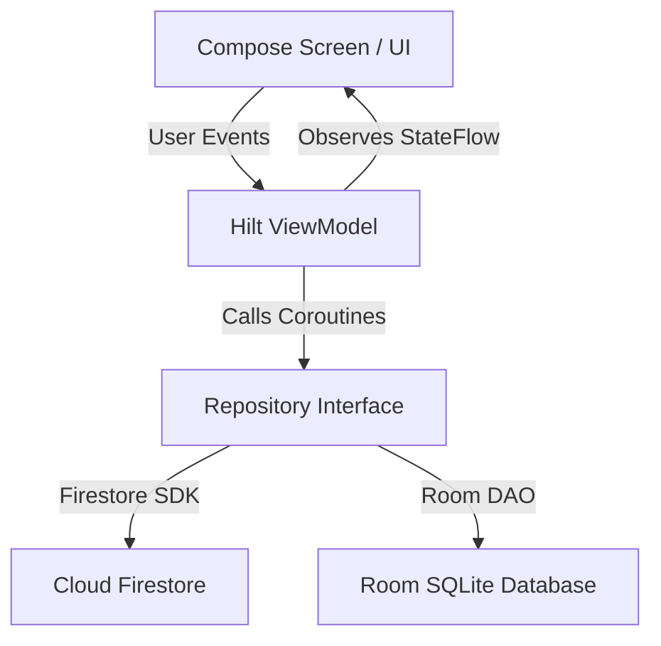

# Technical Architecture & Finance System Report
**SE3092 Personal Finance App** | **Author: Himasha** | **Date: 31 October 2026**

---

## 1. Application Architecture (MVVM & Hilt)

### 1.1 Model-View-ViewModel (MVVM) Pattern
The application follows modern Android MVVM architecture guidelines:
- **UI Layer (`Composables`)**: Declarative Compose screens render state (`UiState`) and forward user events (`onEmailChanged`, `onSaveExpense`, etc.) to the ViewModel.
- **ViewModel Layer (`@HiltViewModel`)**: Owns screen state and business logic. Exposes immutable `StateFlow` streams created using `stateIn()` with `SharingStarted.WhileSubscribed(5000)`.
- **Data Layer (`Repositories`)**: Encapsulates data access from Cloud Firestore, Room SQLite, and Firebase Auth behind clean Kotlin `interface` contracts.

### 1.2 Hilt Dependency Injection
Dependency injection is managed via Dagger Hilt:
- `@SingletonComponent`: Long-lived singleton bindings (`FirebaseAuth`, `FirebaseFirestore`, `AuthRepository`, `ExpenseRepository`).
- `@ViewModelComponent`: Scoped ViewModels (`AuthViewModel`, `ExpenseViewModel`, `DashboardViewModel`, `GoalViewModel`).
- Interface binding using `@Binds` in dedicated Hilt modules (`AuthModule`, `ExpenseModule`, `GoalModule`, `IncomeModule`, `DatabaseModule`).

---

## 2. Navigation Architecture & Protected Route Guarding

### 2.1 Type-Safe Navigation Compose
Destinations are defined as type-safe `@Serializable` data objects in `Routes.kt`:
- `Login`, `Register`, `PasswordReset` (Authentication destinations)
- `Overview`, `Activity`, `TransactionDetail` (Main app destinations)

### 2.2 Navigation Guarding & Session Cleanup
- **Route Guarding**: `AppNavHost` observes `AuthState` from `AuthViewModel`. Unauthenticated requests are automatically directed to `Login`.
- **Backstack Clearing**: Upon sign-out, `navController.navigate(Login) { popUpTo(0) { inclusive = true } }` clears the backstack so the Android back button cannot reopen protected content.

---

## 3. Financial System Logic & USD Conversion

### 3.1 Multi-Currency Support (`Money` & `CurrencyCode`)
- All transactions store the `originalAmountDecimal` (e.g., `$150.00 USD` or `LKR 2,500.00`) alongside the converted base amount in LKR minor units (`baseAmountMinor`).
- **USD Rate Quotes**: Supported via `MANUAL_REFERENCE` or live exchange rate providers (`1 USD = 300.00 LKR` or CBR rates).

### 3.2 Receivables & Settlement
- Receivables track expected inbound funds for projects. Upon receipt, a corresponding Income entry is created with `entryKind = REALIZED_PNL` or `RECEIPT`.

---

## 4. Cloud Firestore Schema & Offline Persistence

### 4.1 NoSQL Collection Structure
Data is strictly isolated per authenticated user UID:
- `/users/{userId}/expenses/{expenseId}` — User expense documents.
- `/users/{userId}/goals/{goalId}` — Savings goal documents.
- `/users/{userId}/goals/{goalId}/contributions/{contributionId}` — Contribution entries.

### 4.2 Offline Snapshot Caching
- `addSnapshotListener` maintains an offline cache. When offline, cached documents are emitted instantly into repository `Flow` streams, ensuring the UI remains fully responsive.
