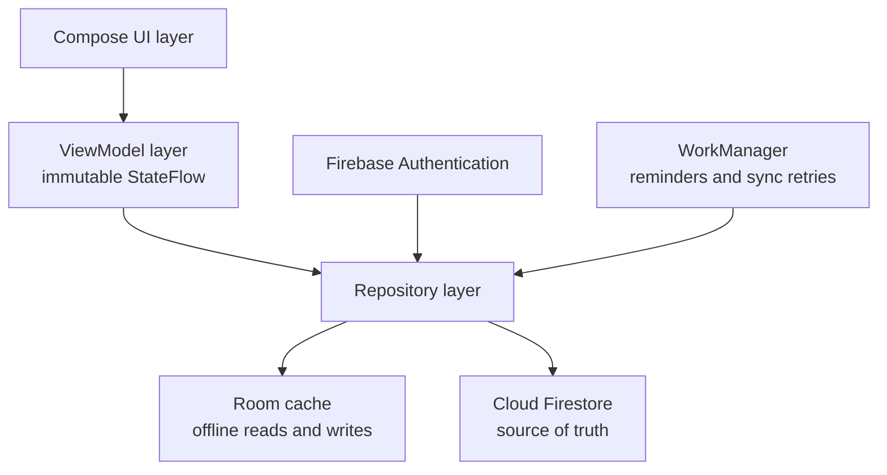
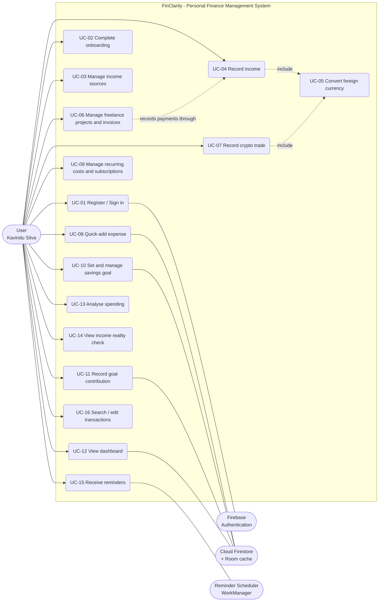
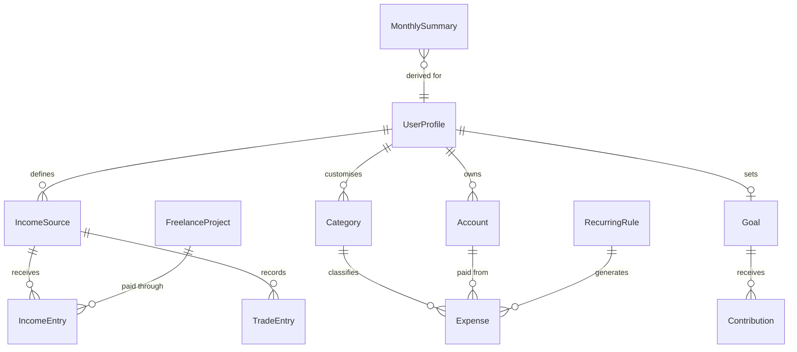

# Software Requirements Specification (SRS)

**FinClarity: Personal Finance Management System for Android**

| Field | Value |
| --- | --- |
| Version | 1.0 |
| Date | 15 October 2026 |
| Module | SE3092 Platform Based Development, Assignment 01 (Year 3, Semester 2, 2026) |
| Prepared by | Malindu Gurunada, Himasha Hettiarachchi, Thilakarathna J K D R S |

For setup and project status, see the [project README](../README.md). For the current code structure and implementation status, see the [application architecture](architecture.md). For persistence design, see the [Firestore schema](firestore-schema.md).

**Purpose.** This document describes the intended purpose, functionality, and requirements of FinClarity, an Android personal finance application designed around one specific user, Mr. Kavindu Silva. It is a communication tool between stakeholders, developers, and testers, ensuring a shared understanding of functional and non-functional expectations. Every requirement is derived from, and traceable to, an observation in Kavindu's scenario (see [Appendix A](#appendix-a---scenario-analysis-and-traceability)).

> **Note:** This SRS describes the **intended** product. The architecture document uses the labels **Implemented**, **Prototype**, and **Planned** to show what exists in the current branch. Requirements here should not be read as completed work.

## Table of contents

1. [Introduction](#1-introduction)
2. [Overall description](#2-overall-description)
3. [Functional requirements](#3-functional-requirements)
4. [Non-functional requirements](#4-non-functional-requirements)
5. [External interface requirements](#5-external-interface-requirements)
6. [Assumptions and dependencies](#6-assumptions-and-dependencies)
7. [Appendices](#7-appendices)
8. [Glossary](#glossary)

---

## 1. Introduction

- **Project name:** FinClarity, Personal Finance Management System for Android
- **Prepared by:** Malindu Gurunada, Himasha Hettiarachchi, Thilakarathna J K D R S
- **Version:** 1.0
- **Date:** 15 October 2026
- **Module:** SE3092 Platform Based Development, Assignment 01 (Year 3, Semester 2, 2026)

## 2. Overall description

### 2.1 Product perspective

FinClarity is a new, self-contained Android application (minimum API 26, target API 34+) written in Kotlin with Jetpack Compose and the MVVM pattern. It is backed by Firebase Authentication and Cloud Firestore, with a Room cache for offline use. It replaces four tools that Kavindu has already tried and abandoned:

1. A Google Sheet ("MacBook Fund")
2. A USD-only Play Store budgeting app
3. A notes file of pasted bank exports
4. His bank's native spending summary

The product does not integrate with any bank, card network, payment app or exchange. All data enters through the user, so the design is built around two ideas:

1. Make each entry so cheap that it survives a busy fortnight.
2. Make the resulting numbers so revealing, and so closely tied to his MacBook goal, that opening the app is rewarding rather than a reminder of failure.

Logically the system has three tiers: the Compose UI layer (screens and state holders only), a ViewModel layer exposing immutable `StateFlow` state, and a Repository layer that mediates between the Room cache and Firestore. Firestore remains the primary persistence layer and the source of truth; Room provides immediate, offline-safe reads and writes.

### 2.2 Product functions

| Function area | Summary |
| --- | --- |
| Account and onboarding | Email/password registration and login (Google Sign-In as bonus). Short onboarding capturing the savings goal (MacBook Pro M4, LKR 490,000, 12 months), current savings (LKR 11,200), expected salary pattern, and the user's own estimate of monthly income. |
| Multi-source income ledger | Separate, typed income sources (salary, freelance, ad revenue, crypto trading), each with its own cadence, currency and certainty, producing a single verified "true monthly income" figure. |
| Multi-currency handling | Income and expenses in LKR, USD, USDT or ETH stored with the original amount, currency, exchange rate and LKR equivalent, so AdSense payouts and trading results are accurate. |
| Freelance project and invoice tracking | Projects with milestones, outstanding balances, payment-to-project reconciliation and overdue-invoice reminders. |
| Crypto net position | Running ledger of realised gains and losses, with year-to-date and per-month net results that can be negative. |
| Low-friction expense capture | Amount-first quick-add reachable in three taps, smart defaults, merchant-to-category memory, offline entry, and back-dating. |
| Committed-cost automation | Recurring rent (LKR 34,000), utilities, gym and subscriptions generated as one-tap-confirm items, plus a subscription register to expose forgotten services. |
| Cash and multi-account awareness | Payment methods and accounts (card, cash, secondary account), with cash withdrawals treated as transfers, not expenses. |
| Savings goal engine | Required monthly saving, actual monthly saving, projected completion date, on-track status, and what-if deadlines. |
| Spending insight views | Committed-versus-discretionary ratio, category breakdown, income by source, top discretionary leaks, and spend-in-goal-terms translation. |
| Reality check | Comparison of the user's own income estimate against recorded actual income. |
| Gentle reminders | Daily capture nudge, payday confirmation, month-start AdSense prompt and invoice follow-ups. |

The use cases for these functions are shown in [Appendix C](#appendix-c---use-case-diagram-and-descriptions).

### 2.3 User characteristics

**Primary user: Mr. Kavindu Silva (25).** A junior software engineer in Colombo with:

- Monthly salary of LKR 120,000-140,000 (paid on the 25th)
- Freelance income of LKR 20,000-90,000 per project
- Google AdSense income in USD (roughly LKR 3,500-19,000 per month)
- Binance crypto trading
- About LKR 11,200 in savings, and a goal of LKR 490,000 for a MacBook Pro M4 within 12 months

The following traits shape the requirements:

- **Technically sharp, low patience for data entry.** He will tolerate no tutorial and no spreadsheet-style upkeep. Every capture action must take seconds, and the app must stay usable after a week of missed entries.
- **Optimistic about income, avoidant about expenses.** The app must show recorded actual income rather than estimates, and present expense data factually and without blame, since avoidance is the reason earlier attempts collapsed.
- **Impulsive with discretionary spending.** He reacts to concrete, goal-denominated consequences (for example, LKR 24,000 of coffee and dining in one month) more than to abstract percentages.
- **Does not think in financial categories.** He lacks an accounting vocabulary, so views must use plain language such as "locked in" versus "your choice".
- **Mobile-first and often in transit.** Expenses such as PickMe rides, UberEats orders and cash purchases occur away from a desk, so capture must work one-handed and offline.

**Secondary users.** Other early-career professionals in Sri Lanka with multi-source, multi-currency, irregular income (freelancers, creators, traders). No administrator role exists; each user can access only their own data.

### 2.4 Constraints

- **Language and build:** 100% Kotlin (no Java in the application layer); Gradle uses the Kotlin DSL.
- **UI:** All UI is built with Jetpack Compose and Material Design 3. XML layouts are not permitted. Single-activity architecture with Navigation Compose.
- **MVVM:** Must be strictly observed.
  - No ViewModel logic in Composables.
  - No data-layer calls from the UI layer.
  - No raw mutable state exposed from ViewModels (`StateFlow`/`LiveData` only).
  - `viewModelScope` for all asynchronous work.
- **Dependency injection:** Hilt (preferred) or Koin. ViewModels must not be instantiated manually inside Composables.
- **Identity:** Firebase Authentication manages identity (email/password mandatory; Google Sign-In optional bonus). No hard-coded user data.
- **Persistence:** Cloud Firestore is the primary persistence layer, with real-time listeners on the dashboard. Firestore Security Rules (`firestore.rules`) must be submitted. Room is used for offline caching.
- **Platform:** The app must install and run on Android 8.0 (API 26) and above and target API 34 or higher.
- **Data entry:** No automatic bank-data import is possible; all transactions are entered by the user.
- **Error handling:** No unhandled exceptions, no blank screens on network failure, no crashes on empty datasets.
- **Backend:** The APK must connect to a live Firebase project (local emulator configurations are not acceptable for submission).
- **Delivery:** Group assignment (maximum three members), due **30 October 2026**, with a live demo. All code, design decisions and documentation must be the group's own work, and AI assistance must be disclosed.

---

## 3. Functional requirements

Priorities follow MoSCoW:

- **Must:** required for the product to solve Kavindu's core problem
- **Should:** important; strongly improves adherence or clarity
- **Could:** valuable enhancement or bonus

Requirement text is deliberately specific to Kavindu's scenario. The scenario source of each requirement is mapped in [Appendix A](#appendix-a---scenario-analysis-and-traceability).

### 3.1 Authentication, onboarding and profile

| ID | Description | Priority |
| --- | --- | --- |
| FR-01 | The system shall allow a new user to register with email and password via Firebase Authentication. | Must |
| FR-02 | The system shall allow login and logout, and shall keep the session persistent so the user is not asked to log in on every launch. | Must |
| FR-03 | The system shall provide password reset by email. | Should |
| FR-04 | The system shall offer Google Sign-In as an alternative to email/password. | Could |
| FR-05 | The system shall isolate each user's data so that an authenticated user can read and write only their own records (enforced by Firestore Security Rules, not only by client code). | Must |
| FR-06 | The system shall run a skippable onboarding (target: under two minutes) capturing: base currency (LKR), savings goal (name, target amount, deadline, amount already saved), expected salary and pay day, and the user's own estimate of monthly income as a range (e.g. LKR 160,000-210,000). | Must |
| FR-07 | The system shall allow the user to delete their account and all associated data. | Should |

### 3.2 Income sources and income recording

| ID | Description | Priority |
| --- | --- | --- |
| FR-08 | The system shall let the user define multiple income sources, each with a type (Salary, Freelance, Ad Revenue, Trading, Other), a default currency, a cadence (fixed monthly date, irregular, or milestone-based) and an optional expected amount or range. | Must |
| FR-09 | The system shall let the user record an income receipt against a source with amount, currency, date received and optional note, and shall edit or delete it later. | Must |
| FR-10 | For any non-LKR income the system shall capture and persist the original amount, original currency, exchange rate applied and the resulting LKR equivalent. The LKR equivalent shall be calculated at entry time and shall not silently change if later rates change (e.g. AdSense is converted by the processor at transfer time). | Must |
| FR-11 | The system shall pre-fill the exchange rate with the most recent rate the user used for that currency, and allow it to be overridden. | Should |
| FR-12 | The system shall distinguish expected income from received income. Only received income counts toward actual totals; expected-but-not-received income shall be displayed separately as "pending". | Must |
| FR-13 | On the configured pay day (the 25th) the system shall prompt the user to confirm the salary, pre-filled with the expected amount, so the actual deposit (LKR 120,000-140,000 depending on bonus) can be recorded or corrected in one tap. | Must |
| FR-14 | At the start of each month the system shall prompt the user to record the previous month's ad revenue payout (USD amount and converted LKR amount). | Should |
| FR-15 | The system shall calculate "true monthly income" as the sum of LKR equivalents of all received income across all sources for the selected month, with a per-source breakdown, in a single place and without the user visiting any other app. | Must |

### 3.3 Freelance projects and invoices

| ID | Description | Priority |
| --- | --- | --- |
| FR-16 | The system shall let the user create a freelance project with client name, project title, agreed total (LKR 20,000-90,000 range supported), currency, and one or more milestones each with an amount and due date. | Must |
| FR-17 | Each freelance payment shall be linked to a project and milestone so the user can always see which payment belongs to which project. | Must |
| FR-18 | The system shall show for every project the amount invoiced, amount received and outstanding balance, with a status (Not invoiced / Invoiced / Partially paid / Paid). | Must |
| FR-19 | The system shall flag invoices unpaid beyond a configurable number of days (default 7) and send a follow-up reminder. | Should |

### 3.4 Cryptocurrency trading

| ID | Description | Priority |
| --- | --- | --- |
| FR-20 | The system shall let the user record a trading result (asset such as USDT/ETH/other, realised gain or loss amount in original currency, rate, LKR equivalent, date). Losses shall be stored as negative values. | Must |
| FR-21 | The system shall maintain a running crypto net position: year-to-date net, net per month and net per asset, so the user can answer "what are my total crypto earnings this year?". | Must |
| FR-22 | Trading results shall appear as their own source in income analysis, and a net-negative month shall reduce, not hide inside, total income. | Must |

### 3.5 Expense capture

| ID | Description | Priority |
| --- | --- | --- |
| FR-23 | The system shall provide a quick-add expense flow reachable from any main screen (persistent action button) in which the user enters amount first, picks a category chip, and saves, completing in no more than three taps after the amount is typed. | Must |
| FR-24 | An expense record shall capture: amount, currency (default LKR), category, payment method/account (card, cash, secondary account, other), date and time (default now, editable), optional merchant/payee, optional note, and whether it came from a recurring rule. | Must |
| FR-25 | The system shall provide default categories pre-classified as Committed or Discretionary ([Appendix E](#appendix-e---default-categories-and-classification)) and allow the user to create categories and change any category's classification. Reclassification shall apply retroactively to all analysis. | Must |
| FR-26 | The system shall suggest merchants as the user types, remember the category last used for each merchant (e.g. PickMe -> Transport), and surface the most-used categories first. | Should |
| FR-27 | Expense entry shall work fully offline; entries made offline shall sync automatically when connectivity returns. | Must |
| FR-28 | The system shall allow editing and deleting expenses, with an undo option immediately after a save or delete. | Must |
| FR-29 | The system shall allow back-dated entries and provide a "catch up" view listing recent days with no entries; missing days shall never be presented as failure. | Should |
| FR-30 | The system shall treat cash withdrawals and inter-account transfers as transfers between accounts, not as expenses, so spending is not double counted. Cash that has been withdrawn but not itemised shall be shown as "unaccounted cash". | Should |
| FR-31 | The system shall support foreign-currency expenses (e.g. USD subscriptions) using the same original-amount / rate / LKR-equivalent model as income. | Should |
| FR-32 | The system shall allow searching and filtering transactions by date range, category, merchant, payment method, source and amount. | Should |

### 3.6 Recurring costs and subscriptions

| ID | Description | Priority |
| --- | --- | --- |
| FR-33 | The user shall be able to define recurring committed costs (for example rent LKR 34,000, gym membership, utilities) with amount, day of month and category. The system shall generate each occurrence as a pending item the user confirms in one tap or adjusts (needed for fluctuating utilities). | Must |
| FR-34 | The system shall maintain a subscription register (name, amount, currency, renewal date, account) showing the total monthly subscription cost, and allow flagging a subscription "intend to cancel". | Should |
| FR-35 | The system shall remind the user before a flagged or any subscription renews and show how long it has been flagged. | Could |

### 3.7 Savings goal

| ID | Description | Priority |
| --- | --- | --- |
| FR-36 | The system shall let the user create a savings goal with name, target amount, deadline and initial saved amount (initially MacBook Pro M4, LKR 490,000, with LKR 11,200 already saved). | Must |
| FR-37 | The system shall calculate and display the required monthly saving to reach the goal by the deadline, recalculated automatically as time passes and contributions are made (e.g. (490,000 - 11,200) / 12 = LKR 39,900 per month at start). | Must |
| FR-38 | The system shall let the user record contributions to the goal and shall display amount saved, amount remaining and percentage complete. | Must |
| FR-39 | The system shall compute the actual monthly saving (received income minus expenses) and compare it with the required amount, showing a status of Ahead, On track or Behind and the shortfall or surplus in LKR. | Must |
| FR-40 | The system shall project a completion date at the current saving rate and show how it differs from the deadline. | Must |
| FR-41 | The system shall express spending in goal terms, for example "LKR 24,000 on coffee and dining this month = 4.9% of your MacBook", and how many days the goal is delayed. | Should |
| FR-42 | The system shall offer what-if deadlines (for example 12, 15 or 18 months) showing the required monthly saving for each, so an unrealistic target can be reshaped instead of abandoned. | Should |
| FR-43 | When income is recorded the system shall prompt the user to set aside part of it for the goal, pre-filled with the current required monthly amount (pay-yourself-first). | Should |
| FR-44 | The user shall be able to edit the goal target or deadline without losing contribution history; the system shall celebrate 25%, 50% and 75% milestones. | Could |

### 3.8 Dashboard and insight views

| ID | Description | Priority |
| --- | --- | --- |
| FR-45 | The dashboard shall be the launch screen and shall display, for the current month and updated in real time through Firestore listeners: received income, total spent, net saved, goal progress with required-versus-actual saving, committed-versus-discretionary split, and the most recent transactions. | Must |
| FR-46 | The system shall present a committed-versus-discretionary view (chart plus plain-language labels such as "Locked in" and "Your choice"), shown both as a share of spending and as a share of received income. | Must |
| FR-47 | The system shall present a category breakdown for the selected period with drill-down to the underlying transactions. | Must |
| FR-48 | The system shall present income by source for the selected month and a multi-month trend, so variability across salary, freelance, ad revenue and trading is visible. | Must |
| FR-49 | The system shall highlight "where it leaked": the top discretionary categories and merchants of the month with their totals. | Should |
| FR-50 | The system shall show a month-over-month comparison (income, spending, saving rate) for up to the previous six months. | Should |
| FR-51 | The system shall provide an income reality check comparing the user's onboarding estimate with measured average monthly income, and display the difference. | Should |
| FR-52 | The system shall provide an income stability indicator: trailing three-month average, minimum and maximum, and a conservative "safe to plan with" amount for goal planning. | Should |
| FR-53 | The system shall provide a period selector (this month default, previous months, custom range) that applies consistently to every view. | Should |
| FR-54 | Every list and chart shall have a meaningful empty state with a call to action instead of a blank or broken screen. | Must |

### 3.9 Reminders, settings and synchronisation

| ID | Description | Priority |
| --- | --- | --- |
| FR-55 | The system shall send at most one optional daily capture reminder at a user-chosen time, suppressed if an entry has already been made that day, with a quick-add action in the notification. | Should |
| FR-56 | The system shall let the user manage supported currencies, default exchange rates, base currency display, categories, reminder times and the pay day. | Should |
| FR-57 | The system shall synchronise data with Firestore in real time and resolve concurrent edits deterministically (last write wins at document level using server timestamps). | Must |
| FR-58 | The system shall allow export of transactions for a selected period as CSV. | Could |

### Requirement count by priority

| Priority | Count | Requirement IDs |
| --- | --- | --- |
| Must | 33 | FR-01, 02, 05, 06, 08, 09, 10, 12, 13, 15, 16, 17, 18, 20, 21, 22, 23, 24, 25, 27, 28, 33, 36, 37, 38, 39, 40, 45, 46, 47, 48, 54, 57 |
| Should | 21 | FR-03, 07, 11, 14, 19, 26, 29, 30, 31, 32, 34, 41, 42, 43, 49, 50, 51, 52, 53, 55, 56 |
| Could | 4 | FR-04, 35, 44, 58 |

Total: 58 functional requirements.

---

## 4. Non-functional requirements

Each requirement is stated so that it can be verified in testing or during the live demonstration.

| Category | Requirement |
| --- | --- |
| Usability: friction | Recording an expense shall take no more than 10 seconds and three taps after the amount is typed. Only amount and category are mandatory fields. From first launch, a new user shall reach their first recorded transaction in under two minutes. |
| Usability: emotional safety | Incomplete data shall never produce a discouraging experience: partial months are labelled "so far" with a data-completeness hint, no streak counters are used, and no screen presents blank cells or counts missed days as failure. |
| Usability: plain language | Charts and labels shall be understandable without financial vocabulary (for example "Locked in" versus "Your choice"), and the committed-versus-discretionary split shall be comprehensible within five seconds of viewing. |
| Usability: time to insight | After seven days of normal use the user shall be able to see true monthly income so far, the committed/discretionary split and goal progress without configuring anything further. |
| Performance | Cold start to an interactive dashboard shall take under 3 seconds on a mid-range Android 8.0 device when cached data exists; navigation between main screens under 300 ms; dashboard totals shall refresh within 2 seconds of a change. |
| Offline-first reliability | All create, edit and delete operations shall succeed with no connectivity (Room plus Firestore offline persistence) and synchronise automatically on reconnect without data loss or duplication. The UI shall never block on network availability. |
| Robustness / error handling | No unhandled exceptions or crashes. Network failure shall show cached data with an unobtrusive offline banner and retry. Empty datasets, division-by-zero cases (for example a goal with a past deadline or zero income) and invalid input shall show a clear message. |
| Data accuracy and integrity | Monetary amounts shall be stored as integers in minor units or as exact decimals, never binary floating point. Each foreign-currency record stores original amount, currency, rate and LKR equivalent. Derived totals shall come from a single computation path so the same figure appears identically on every screen. |
| Security | Access is via Firebase Authentication only. Firestore Security Rules shall restrict every path to the authenticated owner (`request.auth.uid` equals the user id), validate field types, require positive amounts and allowed currency codes, and deny all other access. No credentials or API keys beyond the standard Firebase configuration shall be hard-coded; all traffic uses TLS. |
| Privacy | Financial data is visible only to its owner, is not shared with third parties, is not used for advertising, and can be deleted entirely by the user (FR-07). |
| Scalability and cost | The data model shall support several years of data for one user. Dashboard and analysis queries shall be bounded to a period (by month) and paged (50 records per page) so that read cost and latency do not grow with total history. |
| Compatibility | The app shall install and run on Android 8.0 (API 26) through current releases, targeting API 34 or higher, on phone screen sizes from about 5 to 7 inches, in light and dark themes. |
| Maintainability and architecture | Strict UI -> ViewModel -> Repository -> data source layering; single-activity Navigation Compose graph; Hilt injection; unidirectional data flow with immutable `StateFlow` UI state; no business logic inside Composables; Kotlin only. ViewModels and repositories shall be unit-testable without Android UI. |
| Accessibility and localisation | Material Design 3 components, minimum 48 dp touch targets, sufficient colour contrast, content descriptions for charts and icons, support for system font scaling. Currency shown as "LKR 120,000.00" with locale-appropriate dates. Colour is never the sole carrier of meaning in charts. |
| Battery and notification etiquette | Background work uses WorkManager; no more than one routine notification per day; notifications can be disabled per type; the Android 13+ notification permission is requested in context, not at first launch. |
| Testability and demonstrability | The build shall run against a live Firebase project with seeded demo data available, and every core user flow shall be demonstrable end to end within the 15-minute live demo. |

---

## 5. External interface requirements

### User interface

Material Design 3 Compose screens in a single activity:

- Login/Register
- Onboarding
- Dashboard (launch screen)
- Quick-Add Expense (bottom sheet or full screen from a persistent action button)
- Transactions (search/filter/edit)
- Income (sources, receipts, freelance projects and invoices, crypto ledger)
- Goal
- Insights (committed vs discretionary, categories, income by source, trend, reality check)
- Recurring & Subscriptions
- Settings

Primary navigation is a bottom bar with four to five destinations. Annotated wireframes for the three most critical screens (Dashboard, Quick-Add, Goal) are provided in the Technical Design Document.

### Hardware interface

Android smartphone running Android 8.0 or later with a touch screen. Network access is optional for daily use (offline-first) but required for first login and synchronisation.

### Software interfaces

| Interface | Details |
| --- | --- |
| Firebase | Firebase Authentication (email/password; Google Sign-In optional) and Cloud Firestore accessed through the Firebase Android SDK with real-time snapshot listeners and offline persistence enabled. Security rules are deployed from `firestore.rules`. |
| Local | Room database as an offline cache and write-ahead store; WorkManager for reminders and sync retries; Kotlin Coroutines and Flow; Hilt; Navigation Compose; Material 3. |

### Communications interface

HTTPS/TLS connections to Firebase services only. No other external network service is required; exchange rates are entered by the user, avoiding any dependency on a third-party rate API.

### Notification interface

Android notification channels so the user can control each independently:

- Daily capture
- Payday and income prompts
- Invoices and subscriptions

### Data interface

Per-user document hierarchy in Firestore (logical entities in [Appendix F](#appendix-f---logical-data-entities)), described in full with indexing strategy in the [Firestore schema](firestore-schema.md) and the Technical Design Document.

---

## 6. Assumptions and dependencies

- Kavindu owns an Android device running Android 8.0 or later and has an internet connection often enough for background synchronisation, but not continuously.
- Because bank import is not available, all transactions are entered manually; the design assumes entry is encouraged by low friction rather than guaranteed by automation.
- The base currency is Sri Lankan Rupees (LKR). Foreign-currency exchange rates are supplied or confirmed by the user, typically from the amount actually received (for example the LKR credited for an AdSense payout).
- Kavindu's salary is paid on the 25th of each month and varies between LKR 120,000 and LKR 140,000; the expected value used for prompts is a default, never counted as received until confirmed.
- Cryptocurrency results are entered as realised gain or loss; the app does not connect to Binance or value open positions in real time.
- The savings goal is a single primary goal (MacBook Pro M4, approximately LKR 490,000 within 12 months); support for additional goals is optional.
- Default category classifications are sensible starting points that the user may change; reclassification is applied retroactively.
- Firebase services (Authentication, Firestore) remain available and within free-tier or educational quotas for the expected data volume.
- Notification permission may be denied by the user; the app must remain fully usable without reminders.
- The product is for personal use by one account holder; shared or household accounts are out of scope.

---

## 7. Appendices

Appendices A and B show how the scenario was analysed and translated into the requirements above. Appendix C contains the use case diagram and descriptions. Appendices D, E and F provide worked calculations, default category classifications and logical data entities used by the design. A glossary follows.

### Appendix A - Scenario analysis and traceability

The scenario contains no feature list, so requirements were extracted from the narrative itself. Each row ties an observation in the scenario to the underlying need and the requirements that answer it.

| Scenario observation (section) | Derived need | Requirements |
| --- | --- | --- |
| Salary arrives on the 25th but fluctuates LKR 120,000-140,000; he cannot recall the exact deposit (3.2) | Recurring, variable-amount income needs a confirm-on-payday step rather than a fixed figure. | FR-08, 12, 13 |
| Freelance payments are milestone-based, arrive irregularly; forgot to chase invoices twice; could not reconcile payment to project (3.2) | Income must be modelled per project with milestones, outstanding balances and reminders. | FR-16 to 19 |
| AdSense paid monthly in USD, converted at transfer; he never records it (3.2) | Foreign-currency income needs original amount, rate and LKR value, plus a prompt at month start. | FR-10, 11, 14 |
| Crypto gain in Q1, loss in Q3, no running net position (3.2) | Trading is a signed (possibly negative) income stream requiring a cumulative ledger. | FR-20 to 22 |
| Opens four apps and abandons the calculation; estimates income at LKR 160,000-210,000 without validation (3.2) | One screen must give verified total income; the estimate should be compared to reality. | FR-15, 51, 52 |
| Spend fragmented across card, cash, PickMe, UberEats, a secondary-account gym debit, forgotten subscriptions (3.3) | Payment methods and accounts, cash-as-transfer, recurring auto-generation and a subscription register. | FR-24, 30, 33 to 35 |
| LKR 24,000 on coffee and dining in a month was a shock (3.3) | Surface top discretionary leaks and express them in goal terms. | FR-41, 47, 49 |
| No category system; no concept of discretionary versus committed; has never seen a distribution (3.3) | Pre-classified categories and a plain-language committed/discretionary view. | FR-25, 46 |
| MacBook Pro M4 at about LKR 490,000 in 12 months; savings only LKR 11,200; does not know required saving rate (3.4) | Goal engine with required rate, actual rate, projection and status. | FR-36 to 40 |
| Sheet abandoned after incomplete entries felt discouraging (3.4) | No guilt UI: partial-month framing, catch-up view, offline entry, back-dating. | FR-29; NFR emotional safety |
| Sheet formulas broke after row insertions and manual entry exceeded his willingness (3.5, item 1) | Calculations must be automatic and entry minimal. | FR-23, 15; NFR accuracy |
| Play Store app was USD only, had no cloud sync, assumed one income and a fixed budget (3.5, item 2) | Multi-currency, cloud-synchronised, multi-source and non-fixed-budget design. | FR-08, 10, 57 |
| Pasted bank exports became an unreadable block of unlabelled figures (3.5, item 3) | Structured, labelled records with categories and meaning. | FR-24, 25 |
| Bank summary missed cash and secondary account and mislabelled a PickMe fare as online retail (3.5, item 4) | All channels captured by the user; merchant-to-category memory he can correct. | FR-24, 26, 30 |
| Previous tools did not connect daily behaviour to the goal (4.1) | Dashboard goal strip, spend-in-goal-terms, pay-yourself-first prompt. | FR-41, 43, 45 |
| "Would he still be using it six months from now?" (8) | Retention depends on low friction, gentle reminders and reward-oriented feedback. | FR-27, 55; NFR friction |

### Appendix B - Why each previous tool failed and how this design responds

The four failures share a common root cause stated in the scenario: none was designed for irregular multi-source income, impulsive spending, a quantified goal and low tolerance for data-entry friction. They fail at the behavioural level in recurring ways, summarised below with the design decision that prevents each.

| Failure pattern | Seen in | Behaviour | Design response |
| --- | --- | --- | --- |
| Too manual | Google Sheet; notes app | Entry cost exceeded motivation; formulas required upkeep. | Amount-first quick-add, smart defaults, recurring auto-generation, all analytics computed automatically (FR-23, 26, 33). |
| Too rigid | Play Store app | Single currency, single income, fixed budget. | Typed income sources with cadence and currency; no mandatory fixed budget (FR-08, 10). |
| Too narrow in data coverage | Bank summary | Missed cash and secondary account; wrong categorisation. | Payment methods/accounts, cash transfers, user-correctable merchant memory (FR-24, 26, 30). |
| Unpleasant to return to | Google Sheet | Gaps felt like failure; no payoff for opening. | Partial-month framing, catch-up view, goal-linked rewards and instant insight (FR-29, 41, 45; NFR). |
| Disconnected from the goal | All four | Daily behaviour was never tied to the MacBook target. | Goal strip on dashboard, required vs actual saving, completion projection (FR-37 to 41, 45). |

### Appendix C - Use case diagram and descriptions

*Figure C-1: Use case diagram. UC-04 and UC-07 include UC-05; UC-06 (freelance payments) records its payments through UC-04.*

| ID | Use case | Actors | Description | Requirements |
| --- | --- | --- | --- | --- |
| UC-01 | Register / Sign in | User; Firebase Auth | Create account or log in with email/password (or Google); session persists. | FR-01 to 05 |
| UC-02 | Complete onboarding | User | Set goal, current savings, pay day and own income estimate. | FR-06, 36 |
| UC-03 | Manage income sources | User | Create/edit Salary, Freelance, Ad Revenue, Trading sources with currency and cadence. | FR-08 |
| UC-04 | Record income | User | Log a receipt (salary confirmation, payout, payment); pending becomes received; offers goal set-aside. | FR-09, 12 to 15, 43 |
| UC-05 | Convert foreign currency | System (included) | Store original amount, rate and LKR equivalent for USD/USDT/ETH values. | FR-10, 11, 31 |
| UC-06 | Manage freelance projects & invoices | User | Create projects and milestones, link payments, view outstanding, follow up overdue invoices. | FR-16 to 19 |
| UC-07 | Record crypto trade | User | Enter signed realised result; view YTD net and per-asset position. | FR-20 to 22 |
| UC-08 | Quick-add expense | User; Firestore | Amount, category, save; offline capable; undo. | FR-23 to 28 |
| UC-09 | Manage recurring costs & subscriptions | User | Define rent, gym, utilities and subscriptions; confirm generated items; flag to cancel. | FR-33 to 35 |
| UC-10 | Set & manage savings goal | User; Firestore | Create/edit goal; see required monthly saving, projection and what-if deadlines. | FR-36, 37, 40, 42, 44 |
| UC-11 | Record goal contribution | User; Firestore | Log savings toward the goal; update progress and status. | FR-38, 39 |
| UC-12 | View dashboard | User; Firestore | Real-time month overview: income, spend, net, goal strip, split, recent items. | FR-45, 54 |
| UC-13 | Analyse spending | User | Committed vs discretionary, categories, top leaks, month-over-month. | FR-46, 47, 49, 50, 53 |
| UC-14 | View income reality check | User | Compare estimate with measured income; see stability and income by source. | FR-48, 51, 52 |
| UC-15 | Receive reminders | User; Scheduler | Daily capture, payday, AdSense, invoice and subscription reminders. | FR-14, 19, 35, 55 |
| UC-16 | Search / edit transactions | User | Find, correct or delete past income and expense entries; back-date; catch up. | FR-28, 29, 32 |

### Appendix D - Worked examples from the scenario

**Required saving rate.** Remaining = 490,000 - 11,200 = **LKR 478,800**. Over 12 months this requires **LKR 39,900 per month**. After a month in which LKR 20,000 is saved, the remaining 11 months require (478,800 - 20,000) / 11 = **LKR 41,709 per month**; the system recalculates this automatically.

**Feasibility signal.** The scenario states roughly LKR 1.6 million earned over 12 months with only LKR 11,200 saved. Taken at face value, this implies average income near LKR 133,000 per month and average spending near LKR 132,000, a saving rate below 1%. LKR 39,900 is therefore about 30% of that average income. The goal screen must make this gap visible and offer what-if deadlines (FR-42) rather than leaving the target abstract.

**Estimate versus reality.** Kavindu's own estimate is LKR 160,000-210,000 per month, while the figures above suggest an average near LKR 133,000. Recording actual income lets the reality check (FR-51) show this difference using his own data.

**Spending in goal terms.** LKR 24,000 on coffee and casual dining equals 24,000 / 490,000 = **4.9%** of the MacBook, or about **0.6** of one month's required saving (24,000 / 39,900).

**Foreign currency income.** An AdSense payout of USD 60 credited as LKR 18,000 is stored as:

| Field | Value |
| --- | --- |
| Original amount | 60 |
| Original currency | USD |
| Rate (LKR per unit) | 300.00 |
| LKR equivalent | 18,000 |

The stored LKR value does not change when later rates change.

### Appendix E - Default categories and classification

Defaults are starting points. Each can be reclassified by the user (FR-25). "Committed" means costs largely outside day-to-day choice; "Discretionary" means costs he can change today.

| Category | Default class | Scenario link / note |
| --- | --- | --- |
| Rent & Housing | Committed | LKR 34,000 monthly rent |
| Utilities | Committed | Electricity, water, internet; variable amount but not optional |
| Subscriptions | Committed | Two services he intended to cancel; reclassify when flagged |
| Gym | Committed | Auto-debited from a secondary account |
| Groceries | Committed | Essential food at home |
| Transport (commute) | Committed | Required travel to work |
| Rides (PickMe, Uber) | Discretionary | Convenience rides; merchant memory maps PickMe here |
| Food Delivery (UberEats) | Discretionary | Delivered meals |
| Coffee & Dining Out | Discretionary | Source of the LKR 24,000 shock |
| Shopping & Gadgets | Discretionary | Impulse purchases |
| Entertainment | Discretionary | Leisure and events |
| Other / Uncategorised | Discretionary | Default until classified; user is prompted to review |

### Appendix F - Logical data entities

Key entities implied by the requirements. The physical Firestore collection structure, indexes and multi-currency fields are specified in the [Firestore schema](firestore-schema.md) and the Technical Design Document.

| Entity | Key attributes |
| --- | --- |
| UserProfile | Base currency, pay day, expected salary, own income estimate range, reminder settings. |
| IncomeSource | Type, name, default currency, cadence, expected amount or range, active flag. |
| IncomeEntry | Source reference, original amount, currency, exchange rate, LKR equivalent, date received, project/milestone reference (optional), note. |
| FreelanceProject / Milestone | Client, title, agreed total, milestone amounts and due dates, invoice status, outstanding balance. |
| TradeEntry | Asset, signed realised result, currency, rate, LKR equivalent, date. |
| Expense | Amount, currency, rate, LKR equivalent, category reference, account/payment method, merchant, date, note, recurring rule reference. |
| Category | Name, class (Committed / Discretionary), icon, default flag. |
| Account | Name and type (bank card, cash, secondary account, wallet). |
| RecurringRule / Subscription | Amount, day of month, category, account, next occurrence, cancel-intent flag. |
| Goal / Contribution | Name, target amount, deadline, initial saved; contribution amount and date. |
| MonthlySummary (derived) | Pre-aggregated totals per month for fast dashboard reads, rebuilt from entries. |

---

## Glossary

| Term | Definition |
| --- | --- |
| Committed spending | Costs largely fixed or unavoidable in the short term, such as rent, utilities and subscriptions. |
| Discretionary spending | Costs the user can reduce immediately, such as dining out, food delivery and impulse shopping. |
| True monthly income | Sum of all income actually received in a month, converted to LKR, across every source. |
| Pending (expected) income | Income the user anticipates but has not yet confirmed as received. |
| Income source | A distinct channel of earnings: salary, freelance, ad revenue or trading. |
| Exchange rate (applied) | The LKR per unit of foreign currency recorded with a transaction at the time it occurred. |
| LKR equivalent | The rupee value of a foreign-currency amount computed using the applied rate and stored permanently. |
| Net position (crypto) | Cumulative realised gains minus losses over a period. |
| Required monthly saving | Remaining goal amount divided by the months left until the deadline. |
| Saving rate | Received income minus expenses over a period, optionally as a percentage of income. |
| Quick-add | The three-tap expense entry flow optimised for speed. |
| Reality check | Comparison between the user's estimated income and the income measured from entries. |
| MVVM | Model-View-ViewModel: an architecture separating UI, state holders and data access. |
| Firestore Security Rules | Server-enforced access control for Firestore documents. |
| Room | Android's SQLite abstraction used here as an offline cache. |
| MoSCoW | Must / Should / Could prioritisation scheme. |
