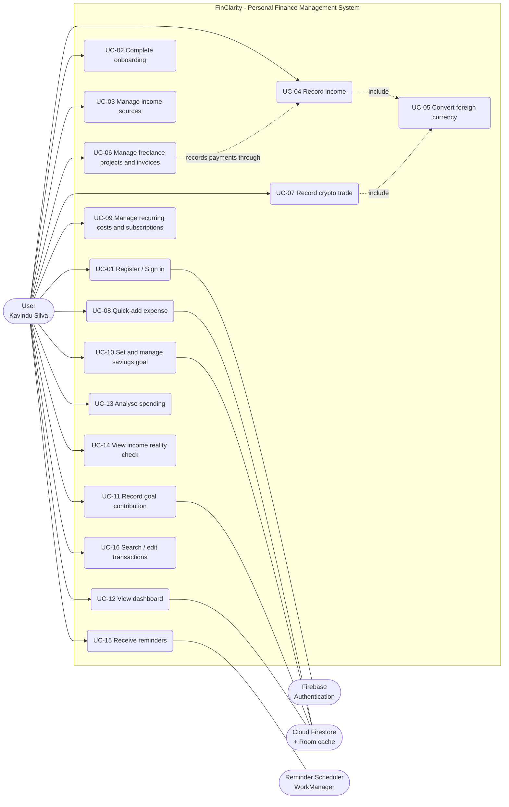

# Use Case Diagram

This document contains the use case diagram and use case descriptions for FinClarity. It corresponds to Appendix C of the [Software Requirements Specification](srs.md). Requirement IDs (FR-xx) refer to the functional requirements in section 3 of the SRS.

## Actors

| Actor | Role |
| --- | --- |
| User (Kavindu Silva) | Primary actor who records income and expenses, manages the savings goal, and views insights. |
| Firebase Authentication | Handles registration, sign-in, and session persistence. |
| Cloud Firestore (+ Room cache) | Stores user data and provides real-time updates and offline support. |
| Reminder Scheduler (WorkManager) | Triggers daily capture, payday, AdSense, invoice, and subscription reminders. |

## Diagram

*Figure C-1: Use case diagram. UC-04 and UC-07 include UC-05; UC-06 (freelance payments) records its payments through UC-04.*

## Relationships

| Relationship | Meaning |
| --- | --- |
| UC-04 includes UC-05 | Recording income in a foreign currency always stores the original amount, rate, and LKR equivalent. |
| UC-07 includes UC-05 | Recording a crypto trade uses the same currency conversion. |
| UC-06 records through UC-04 | Freelance payments are saved as income receipts linked to a project and milestone. |

## Use case descriptions

| ID | Use case | Actors | Description | Requirements |
| --- | --- | --- | --- | --- |
| UC-01 | Register / Sign in | User; Firebase Auth | Create account or log in with email/password (or Google); session persists. | FR-01 to 05 |
| UC-02 | Complete onboarding | User | Set goal, current savings, pay day and own income estimate. | FR-06, 36 |
| UC-03 | Manage income sources | User | Create/edit Salary, Freelance, Ad Revenue, Trading sources with currency and cadence. | FR-08 |
| UC-04 | Record income | User | Log a receipt (salary confirmation, payout, payment); pending becomes received; offers goal set-aside. | FR-09, 12 to 15, 43 |
| UC-05 | Convert foreign currency | System (included) | Store original amount, rate and LKR equivalent for USD/USDT/ETH values. | FR-10, 11, 31 |
| UC-06 | Manage freelance projects & invoices | User | Create projects and milestones, link payments, view outstanding, follow up overdue invoices. | FR-16 to 19 |
| UC-07 | Record crypto trade | User | Enter signed realised result; view YTD net and per-asset position. | FR-20 to 22 |
| UC-08 | Quick-add expense | User; Firestore | Amount, category, save; offline capable; undo. | FR-23 to 28 |
| UC-09 | Manage recurring costs & subscriptions | User | Define rent, gym, utilities and subscriptions; confirm generated items; flag to cancel. | FR-33 to 35 |
| UC-10 | Set & manage savings goal | User; Firestore | Create/edit goal; see required monthly saving, projection and what-if deadlines. | FR-36, 37, 40, 42, 44 |
| UC-11 | Record goal contribution | User; Firestore | Log savings toward the goal; update progress and status. | FR-38, 39 |
| UC-12 | View dashboard | User; Firestore | Real-time month overview: income, spend, net, goal strip, split, recent items. | FR-45, 54 |
| UC-13 | Analyse spending | User | Committed vs discretionary, categories, top leaks, month-over-month. | FR-46, 47, 49, 50, 53 |
| UC-14 | View income reality check | User | Compare estimate with measured income; see stability and income by source. | FR-48, 51, 52 |
| UC-15 | Receive reminders | User; Scheduler | Daily capture, payday, AdSense, invoice and subscription reminders. | FR-14, 19, 35, 55 |
| UC-16 | Search / edit transactions | User | Find, correct or delete past income and expense entries; back-date; catch up. | FR-28, 29, 32 |
